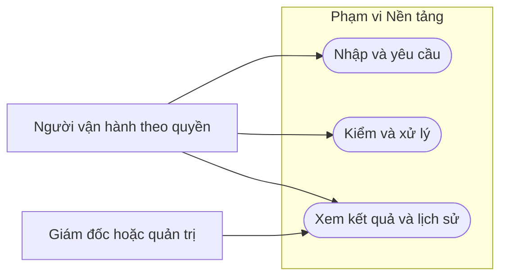

# Sơ đồ use case — Nền tảng

**Draft — thiết kế BA để review; chưa duyệt nghiệp vụ, chưa triển khai phần mềm.**

| Phiên bản | Ngày | Người thực hiện | Thay đổi |
| :--- | :--- | :--- | :--- |
| 0.1.0 | 2026-11-11 | BA | Bổ sung theo kế hoạch; giữ điểm mở và xác nhận đã có |

Sơ đồ tổng quan chia nhóm để đọc; bảng dưới nối từng UC. Include/extend chỉ dùng khi có quan hệ nghiệp vụ, không coi mọi UC tự bao gồm nhau.

| UC | Tên / tài liệu |
| :--- | :--- |
| UC-CORE-001 | [UC-CORE-001 — Đăng nhập nội bộ](../usecases/UC-CORE-001.md) |
| UC-CORE-002 | [UC-CORE-002 — Làm mới phiên](../usecases/UC-CORE-002.md) |
| UC-CORE-003 | [UC-CORE-003 — Đăng xuất](../usecases/UC-CORE-003.md) |
| UC-CORE-004 | [UC-CORE-004 — Xác thực 2 bước](../usecases/UC-CORE-004.md) |
| UC-CORE-005 | [UC-CORE-005 — Đổi mật khẩu](../usecases/UC-CORE-005.md) |
| UC-CORE-006 | [UC-CORE-006 — Cấp lại mật khẩu](../usecases/UC-CORE-006.md) |
| UC-CORE-007 | [UC-CORE-007 — Tạo tài khoản nội bộ](../usecases/UC-CORE-007.md) |
| UC-CORE-008 | [UC-CORE-008 — Khoá / mở khoá tài khoản](../usecases/UC-CORE-008.md) |
| UC-CORE-009 | [UC-CORE-009 — Sửa vai trò và cơ sở](../usecases/UC-CORE-009.md) |
| UC-CORE-010 | [UC-CORE-010 — Xem nhật ký đăng nhập](../usecases/UC-CORE-010.md) |
| UC-CORE-011 | [UC-CORE-011 — Kiểm quyền mỗi yêu cầu](../usecases/UC-CORE-011.md) |
| UC-CORE-012 | [UC-CORE-012 — Xem ma trận vai trò – quyền](../usecases/UC-CORE-012.md) |
| UC-CORE-013 | [UC-CORE-013 — Uỷ quyền duyệt khi vắng](../usecases/UC-CORE-013.md) |
| UC-CORE-014 | [UC-CORE-014 — Tài khoản dịch vụ cho agent](../usecases/UC-CORE-014.md) |
| UC-CORE-015 | [UC-CORE-015 — Ghi nhật ký thay đổi](../usecases/UC-CORE-015.md) |
| UC-CORE-016 | [UC-CORE-016 — Tra cứu nhật ký](../usecases/UC-CORE-016.md) |
| UC-CORE-017 | [UC-CORE-017 — Bắt buộc lý do](../usecases/UC-CORE-017.md) |
| UC-CORE-018 | [UC-CORE-018 — Huỷ thay cho xoá](../usecases/UC-CORE-018.md) |
| UC-CORE-019 | [UC-CORE-019 — Quản lý tham số](../usecases/UC-CORE-019.md) |
| UC-CORE-020 | [UC-CORE-020 — Duyệt thay đổi tham số](../usecases/UC-CORE-020.md) |
| UC-CORE-021 | [UC-CORE-021 — Tạo thông báo trong hệ thống](../usecases/UC-CORE-021.md) |
| UC-CORE-022 | [UC-CORE-022 — Trạng thái thông báo](../usecases/UC-CORE-022.md) |
| UC-CORE-023 | [UC-CORE-023 — Gửi qua kênh ngoài](../usecases/UC-CORE-023.md) |
| UC-CORE-024 | [UC-CORE-024 — Tải tệp lên](../usecases/UC-CORE-024.md) |
| UC-CORE-025 | [UC-CORE-025 — Tác vụ nền](../usecases/UC-CORE-025.md) |
| UC-CORE-026 | [UC-CORE-026 — Kiểm tra sức khoẻ](../usecases/UC-CORE-026.md) |
