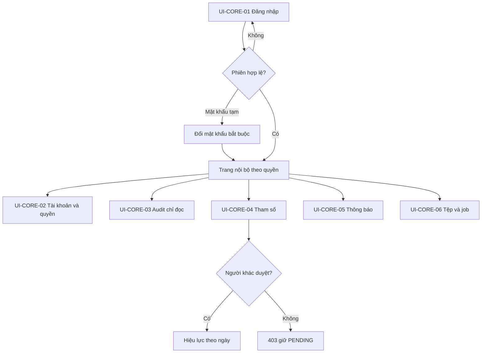

# User flow nền tảng

**Draft: thiết kế BA để review; chưa duyệt nghiệp vụ, chưa triển khai phần mềm.**

| Phiên bản | Ngày | Người thực hiện | Thay đổi |
| :--- | :--- | :--- | :--- |
| 0.1.0 | 2026-11-11 | BA | Bổ sung theo kế hoạch; giữ điểm mở và xác nhận đã có |

## Điều hướng

Loading khóa gửi trùng; Empty nêu chưa có bản ghi; Error giữ input không bí mật và requestId; Offline không báo đã lưu. 409 giữ nội dung để đối chiếu bản mới, không overwrite. Hủy trước submit không ghi. Sau submit mất response: đối soát resource/key; mật khẩu tạm không replay. Thiếu quyền403; record ngoài scope404; UI không thay bảo vệ server. Token/mật khẩu không lưu localStorage, không đưa vào audit.

[HTML6 màn](../html-wireframe/foundation-workbench.html) mô phỏng riêng vài nhánh review; không mô phỏng đầy đủ26FR và không chứng minh auth/backend đã có. [UC](../srs/usecase-diagram.md), [API](../api/api-spec.md).
