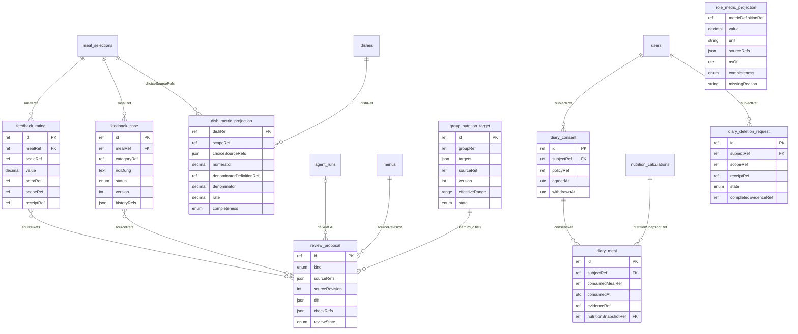

# ERD E12: kế thừa và delta đề xuất

Nháp có điều kiện · 16/11/2026 · Chưa phê duyệt, chưa triển khai.

| Phiên bản | Ngày | Người thực hiện | Nội dung |
| :--- | :--- | :--- | :--- |
| 0.1.0 | 2026-11-16 | BA | Khởi tạo: vẽ quan hệ cho 9 thực thể logic trong từ điển dữ liệu E12. Không thêm thực thể hay trường |

Sơ đồ chỉ vẽ lại [từ điển dữ liệu E12](data-dictionary.md). **Schema chung giữ 65 bảng**; ERD nền có khung `feedbacks` nhưng DBML chưa có bảng phản hồi. Không DDL, không migration. Hai projection (`dish_metric_projection`, `role_metric_projection`) là khung nhìn đọc, không phải bảng nguồn. Không có quan hệ tới `eater_health_profiles`.

## 1. Sơ đồ

`meal_selections`, `dishes`, `menus`, `users`, `nutrition_calculations`, `agent_runs` là bảng có sẵn trong [DBML tổng](../../nen-tang/srs/schema.dbml). Trường "nội dung về bữa" của khiếu nại được viết là `noiDung` để hợp cú pháp sơ đồ. Quan hệ giữa `review_proposal` và `group_nutrition_target` là cách đọc của BA từ cột `checkRefs`, cần xác nhận.

## 2. Ràng buộc cần review

| Nhóm | Ràng buộc | Căn cứ / gate |
| :--- | :--- | :--- |
| Phản hồi | Điểm đánh giá và khiếu nại tách riêng; chỉ thang đã duyệt | FR-FB-RATE-001, FR-FB-CASE-001; E12-Q01/03 |
| Tỷ lệ chọn | Chỉ từ lựa chọn thật E6, tách tự chọn với gán mặc định; mẫu số chưa chọn thì `rate` để trống | FR-FB-SELR-001; E12-Q04 |
| Chỉ số | Giá trị null khi thiếu, không mặc định 0; mỗi ô có định nghĩa và nguồn | FR-RPT-ROLE-001; E12-Q06 |
| Đề xuất | Không ghi MENU, CRM, PUR; nguồn mới tạo bản mới, không sửa bản cũ | FR-AIO-*; E12-Q09 |
| Mục tiêu nhóm | Nhóm phi y tế; không có subjectRef cá nhân | FR-NUTR-GRPT-001; E12-Q13 |
| Nhật ký | Chỉ chủ thể đọc; lựa chọn hay giao nhận không chứng minh đã ăn; xóa không xóa nguồn E6, E7 | FR-NUTR-DREC/DDEL; E12-Q15/16/17 |
