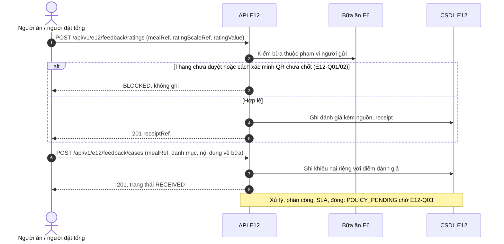
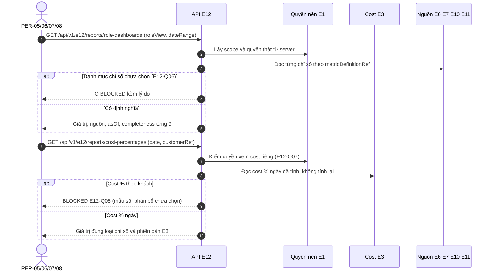
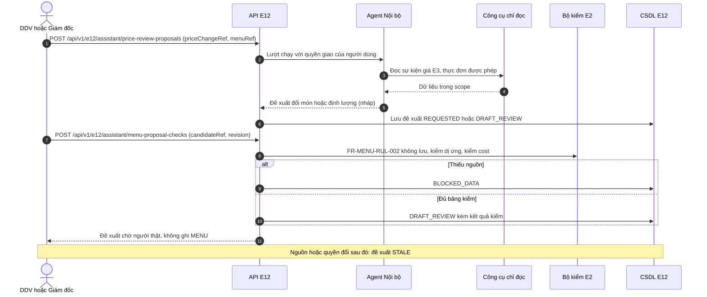
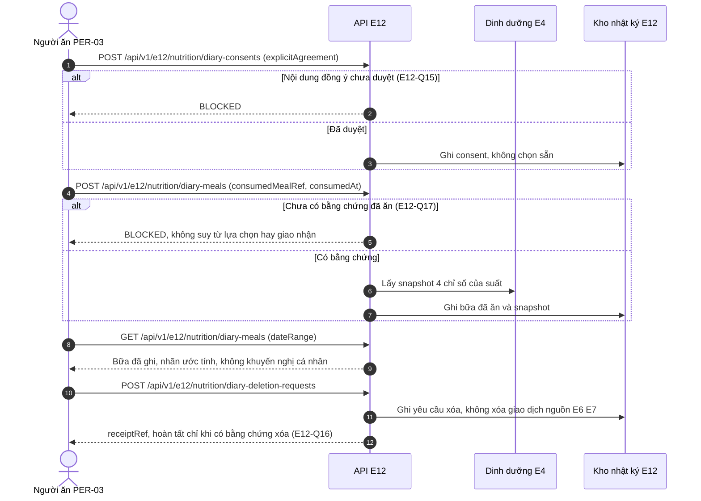

# Sơ đồ tuần tự E12: Phản hồi và báo cáo

Nháp có điều kiện · 16/11/2026 · Chưa phê duyệt, chưa triển khai, không gọi mô hình AI.

| Phiên bản | Ngày | Người thực hiện | Nội dung |
| :--- | :--- | :--- | :--- |
| 0.1.0 | 2026-11-16 | BA | Khởi tạo: 4 sơ đồ tuần tự theo API-FBR và quy tắc E12 hiện có. Không thêm endpoint, mã lỗi hay quy tắc |

Route lấy từ [API E12](../api/api-spec.md); trạng thái lấy từ [states](states.md). Cách chạy Agent Nội bộ tham chiếu [kiến trúc AI agent](../../nen-tang/srs/agent-architecture.md) ở mức đề xuất.

## 1. Đánh giá và khiếu nại (FEAT-079)

## 2. Dashboard và cost % (FEAT-081)

## 3. Trợ lý nội bộ: rà soát khi giá đổi (FEAT-082)

## 4. Nhật ký bữa đã ăn (FEAT-087, P2)

Envelope, idempotency, receipt và refresh cache là đề xuất; còn BLOCKED E12-Q18. Chưa có bằng chứng chạy.
