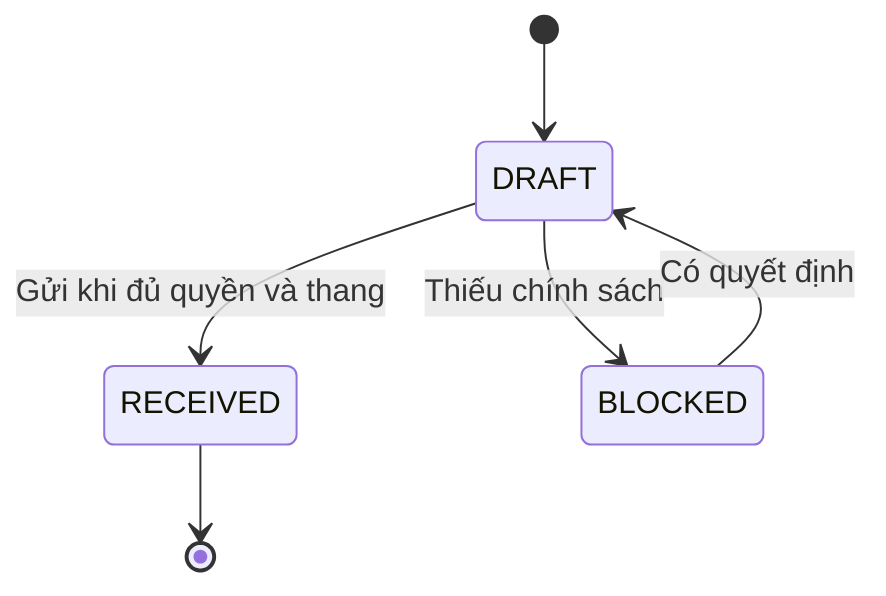
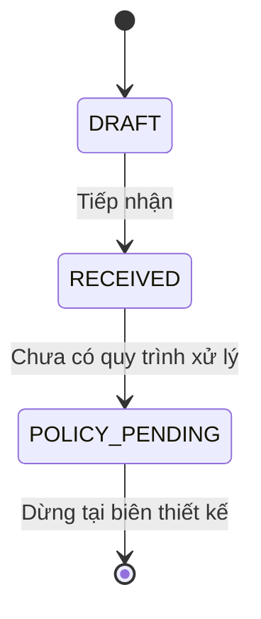
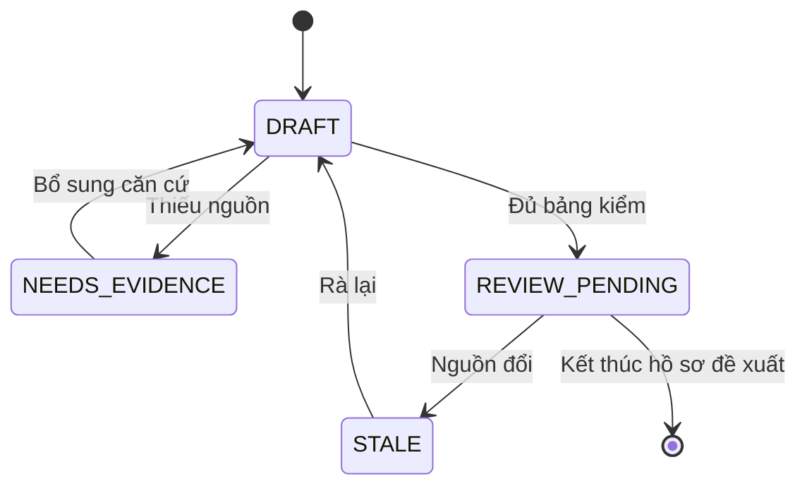
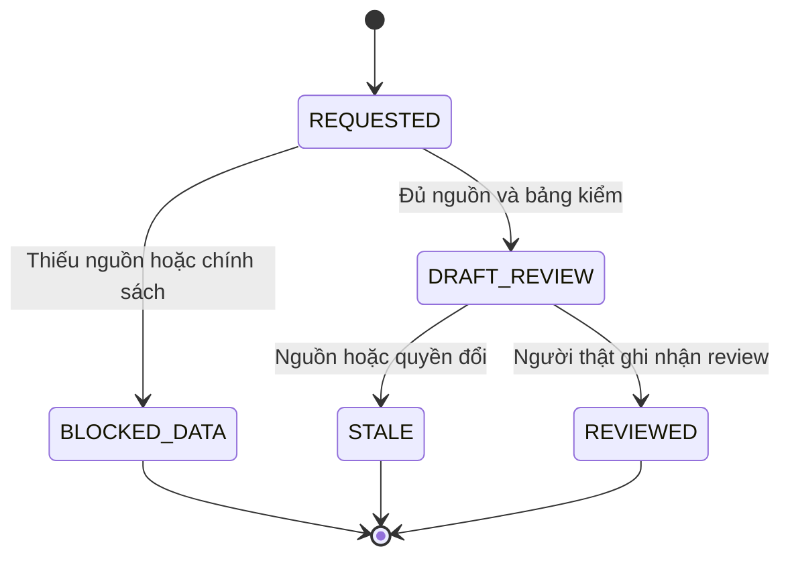
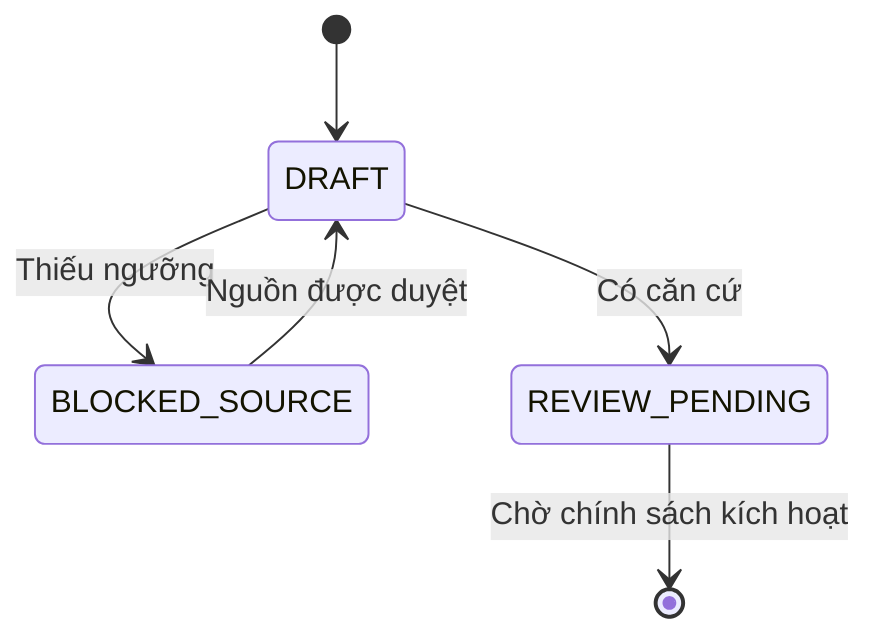

# Trạng thái đề xuất E12

Nháp có điều kiện · Chưa phê duyệt · 12/11/2026.

| Phiên bản | Ngày | Người thực hiện | Nội dung |
| :--- | :--- | :--- | :--- |
| 0.1.0 | 12/11/2026 | BA | Mở riêng tài liệu E12; giữ nguyên câu hỏi chưa trả lời |

Các trạng thái là mô hình nháp. Nút kết thúc ở biên chờ không đồng nghĩa nghiệp vụ đã hoàn tất. Không thiết kế tiếp xử lý khiếu nại hoặc kích hoạt mục tiêu khi policy còn chờ.

## Đánh giá

| Hiện tại | Sự kiện | Guard | Tiếp theo | Vai trò |
| :--- | :--- | :--- | :--- | :--- |
| DRAFT | Gửi | Đúng quyền, thang Q01, receipt Q18 | RECEIVED | Người phản hồi |
| DRAFT | Kiểm | Thiếu Q01/02 hoặc identity | BLOCKED | Hệ thống |
| BLOCKED | Review lại | Có quyết định được cung cấp | DRAFT | Người phản hồi |
| RECEIVED | Kết thúc tiếp nhận | Receipt bền vững | Kết thúc lượt tiếp nhận | Hệ thống |

## Khiếu nại

| Hiện tại | Sự kiện | Guard | Tiếp theo | Vai trò |
| :--- | :--- | :--- | :--- | :--- |
| DRAFT | Gửi khiếu nại | Scope/nguồn đủ; policy input đã duyệt | RECEIVED | PER-02…05 theo quyền |
| RECEIVED | Yêu cầu xử lý | Q03 chưa trả lời | POLICY_PENDING | Người có quyền đọc |
| POLICY_PENDING | Dừng thiết kế | Chưa có SLA/người xử lý | Biên chờ, không phải đóng khiếu nại | BA review |

## Đề xuất thực đơn

| Hiện tại | Sự kiện | Guard | Tiếp theo | Vai trò |
| :--- | :--- | :--- | :--- | :--- |
| DRAFT | Rà nguồn | Thiếu tỷ lệ/kiểm E2/dị ứng/E3 | NEEDS_EVIDENCE | PER-05 |
| NEEDS_EVIDENCE | Bổ sung | Có nguồn đã được duyệt | DRAFT | PER-05 |
| DRAFT | Chuẩn bị review | Đủ kiểm cùng hash, không tự áp dụng | REVIEW_PENDING | PER-05 |
| REVIEW_PENDING | Nguồn đổi | Revision khác | STALE | Hệ thống |
| STALE | Rà lại | Chọn lại nguồn đúng quyền | DRAFT | PER-05 |
| REVIEW_PENDING | Kết thúc tài liệu đề xuất | Không chuyển MENU tự động | Biên bàn giao người thật | Người review |

## Đề xuất AI chờ người thật

| Hiện tại | Sự kiện | Guard | Tiếp theo | Vai trò |
| :--- | :--- | :--- | :--- | :--- |
| REQUESTED | Kiểm | Thiếu nguồn, policy hoặc công cụ đọc hợp lệ | BLOCKED_DATA | Biên điều phối |
| REQUESTED | Trả kết quả | Đúng giao quyền, nguồn; kiểm đủ nếu đổi MENU | DRAFT_REVIEW | Hệ thống |
| DRAFT_REVIEW | Nguồn/quyền đổi | Không còn cùng revision/scope | STALE | Hệ thống |
| DRAFT_REVIEW | Ghi nhận review | Người thật, policy review Q09/11/12 | REVIEWED | Người review chưa chỉ định |
| REVIEWED / BLOCKED_DATA / STALE | Kết thúc lượt | Không gọi công cụ ghi nghiệp vụ | Kết thúc đề xuất, không thực thi | Hệ thống |

## Mục tiêu nhóm

| Hiện tại | Sự kiện | Guard | Tiếp theo | Vai trò |
| :--- | :--- | :--- | :--- | :--- |
| DRAFT | Kiểm nguồn | Chưa có NUTR-Q01–04/Q13 | BLOCKED_SOURCE | PER-05 |
| BLOCKED_SOURCE | Bổ sung | Có nguồn được phê duyệt | DRAFT | PER-05 |
| DRAFT | Đưa review | Đủ nguồn và phiên bản | REVIEW_PENDING | PER-05 |
| REVIEW_PENDING | Dừng ở cổng | Q14 về kích hoạt/ưu tiên chưa trả lời | Biên chờ; chưa ACTIVE | Người review |

