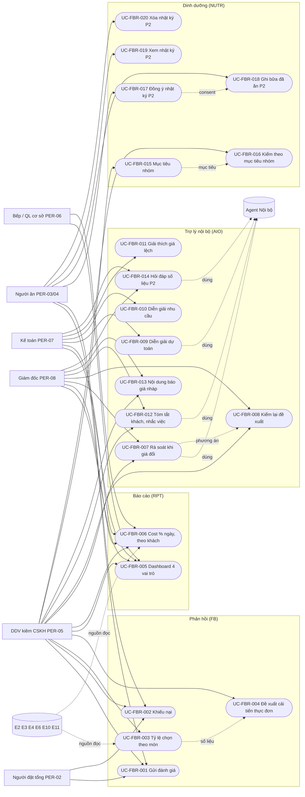

# Sơ đồ use case E12: Phản hồi và báo cáo

Nháp có điều kiện · 16/11/2026 · Chưa phê duyệt, chưa triển khai, không gọi mô hình AI.

| Phiên bản | Ngày | Người thực hiện | Nội dung |
| :--- | :--- | :--- | :--- |
| 0.1.0 | 2026-11-16 | BA | Khởi tạo: sơ đồ actor và ma trận FR, UC, màn hình, API cho 20 UC hiện có. Không thêm FR hoặc UC |

File này chỉ vẽ lại phạm vi trong [SRS E12](spec.md), [danh mục UC](../usecases/index.md) và [màn hình](../ui/screens.md). Bốn feature AI (FEAT-082 đến FEAT-085) chạy qua Agent Nội bộ với quyền của người dùng; đầu ra chỉ là đề xuất nháp chờ người thật.

## 1. Tác nhân

| Tác nhân | Persona | Ghi chú |
| :--- | :--- | :--- |
| Người đặt tổng | PER-02 | Đánh giá, khiếu nại |
| Người ăn có tài khoản | PER-03 | Đánh giá, khiếu nại, nhật ký bữa đã ăn (P2) |
| Người ăn qua QR | PER-04 | Đánh giá, khiếu nại; cách xác minh chờ E12-Q02 |
| Dinh dưỡng viên kiêm CSKH | PER-05 | Phân tích lựa chọn, đề xuất cải tiến, dashboard, mục tiêu nhóm, hỗ trợ CRM |
| Bếp trưởng / Quản lý cơ sở | PER-06 | Dashboard theo vai trò |
| Kế toán | PER-07 | Dashboard, cost %, diễn giải dự toán, nhu cầu, giá lệch, hỏi đáp số liệu |
| Giám đốc | PER-08 | Dashboard, cost %, rà soát giá, hỗ trợ CRM, hỏi đáp số liệu |
| Agent Nội bộ (AIO) | Hệ thống | Công cụ chỉ đọc theo giao quyền người dùng và `svc-agent-noi-bo` |
| Nguồn E2, E3, E4, E6, E10, E11 | Hệ thống | Lựa chọn thật, cost %, dinh dưỡng, CRM, nhu cầu mua |

## 2. Sơ đồ

Nhật ký bữa đã ăn (FEAT-087) chỉ ghi bữa và giá trị dinh dưỡng của suất; không thu, suy luận hay lưu sức khỏe, không dùng FEAT-046/047. Người ăn PER-04 dùng nhật ký hay không còn chờ E12-Q15, E12-Q17 nên sơ đồ gộp chung nhóm "Người ăn".

## 3. Ma trận FR, UC, màn hình, API

| UC | FR | Feature | Tác nhân chính | Màn hình | API | Gate chính |
| :--- | :--- | :--- | :--- | :--- | :--- | :--- |
| [UC-FBR-001](../usecases/UC-FBR-001.md) | FR-FB-RATE-001 | FEAT-079 | PER-02/03/04/05 | UI-FBR-01 | API-FBR-001 | E12-Q01/02 |
| [UC-FBR-002](../usecases/UC-FBR-002.md) | FR-FB-CASE-001 | FEAT-079 | PER-02/03/04/05 | UI-FBR-02 | API-FBR-002 | E12-Q02/03 |
| [UC-FBR-003](../usecases/UC-FBR-003.md) | FR-FB-SELR-001 | FEAT-080 | PER-05 | UI-FBR-03 | API-FBR-003 | E12-Q04 |
| [UC-FBR-004](../usecases/UC-FBR-004.md) | FR-FB-PROP-001 | FEAT-080 | PER-05 | UI-FBR-04 | API-FBR-004 | E12-Q05 |
| [UC-FBR-005](../usecases/UC-FBR-005.md) | FR-RPT-ROLE-001 | FEAT-081 | PER-05/06/07/08 | UI-FBR-05 | API-FBR-005 | E12-Q06/07 |
| [UC-FBR-006](../usecases/UC-FBR-006.md) | FR-RPT-CPCT-001 | FEAT-081 | PER-05/06/07/08 | UI-FBR-06 | API-FBR-006 | E12-Q07/08 |
| [UC-FBR-007](../usecases/UC-FBR-007.md) | FR-AIO-PRRV-001 | FEAT-082 | PER-05/08 | UI-FBR-07 | API-FBR-007 | E12-Q09 |
| [UC-FBR-008](../usecases/UC-FBR-008.md) | FR-AIO-RCHK-001 | FEAT-082 | PER-05/08 | UI-FBR-07 | API-FBR-008 | E12-Q09 |
| [UC-FBR-009](../usecases/UC-FBR-009.md) | FR-AIO-ESTR-001 | FEAT-083 | PER-07 | UI-FBR-08 | API-FBR-009 | E12-Q09 |
| [UC-FBR-010](../usecases/UC-FBR-010.md) | FR-AIO-DEMR-001 | FEAT-083 | PER-07 | UI-FBR-08 | API-FBR-010 | E12-Q09; E11-Q01 |
| [UC-FBR-011](../usecases/UC-FBR-011.md) | FR-AIO-PDEV-001 | FEAT-083 | PER-07 | UI-FBR-08 | API-FBR-011 | E12-Q10 |
| [UC-FBR-012](../usecases/UC-FBR-012.md) | FR-AIO-CRMS-001 | FEAT-084 | PER-05/08 | UI-FBR-09 | API-FBR-012 | E12-Q11 |
| [UC-FBR-013](../usecases/UC-FBR-013.md) | FR-AIO-CRMQ-001 | FEAT-084 | PER-05/08 | UI-FBR-09 | API-FBR-013 | E12-Q11 |
| [UC-FBR-014](../usecases/UC-FBR-014.md) | FR-AIO-DQA-001 | FEAT-085 (P2) | PER-07/08 | UI-FBR-10 | API-FBR-014 | E12-Q12 |
| [UC-FBR-015](../usecases/UC-FBR-015.md) | FR-NUTR-GRPT-001 | FEAT-086 | PER-05 | UI-FBR-11 | API-FBR-015 | E12-Q13/14; NUTR-Q01 đến Q04 |
| [UC-FBR-016](../usecases/UC-FBR-016.md) | FR-NUTR-GRPC-001 | FEAT-086 | PER-05 | UI-FBR-11 | API-FBR-016 | E12-Q13/14 |
| [UC-FBR-017](../usecases/UC-FBR-017.md) | FR-NUTR-DCON-001 | FEAT-087 (P2) | PER-03 | UI-FBR-12 | API-FBR-017 | E12-Q15 |
| [UC-FBR-018](../usecases/UC-FBR-018.md) | FR-NUTR-DREC-001 | FEAT-087 (P2) | PER-03 | UI-FBR-12 | API-FBR-018 | E12-Q17 |
| [UC-FBR-019](../usecases/UC-FBR-019.md) | FR-NUTR-DVIW-001 | FEAT-087 (P2) | PER-03 | UI-FBR-12 | API-FBR-019 | E12-Q15 |
| [UC-FBR-020](../usecases/UC-FBR-020.md) | FR-NUTR-DDEL-001 | FEAT-087 (P2) | PER-03 | UI-FBR-12 | API-FBR-020 | E12-Q16 |

20/20 FR có đúng một UC; 9/9 feature FEAT-079 đến FEAT-087 có ít nhất một UC. Số liệu đo tài liệu, không đo phần mềm.
