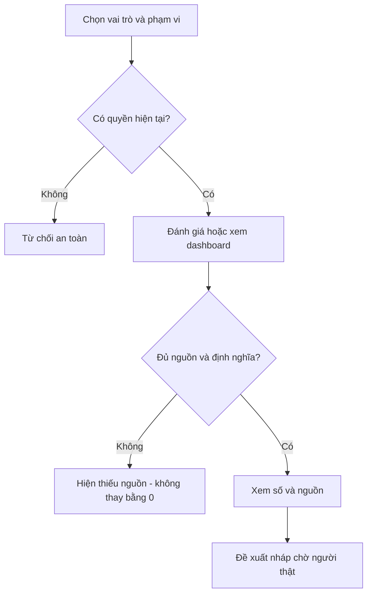
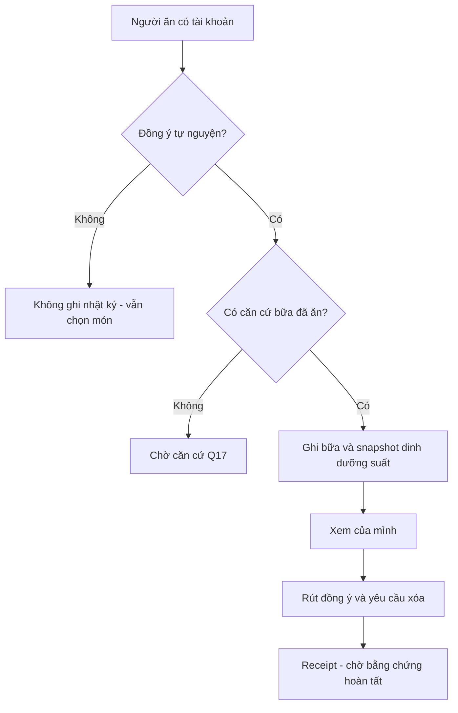

# Luồng người dùng E12

Nháp có điều kiện · Chưa phê duyệt · 12/11/2026.

| Phiên bản | Ngày | Người thực hiện | Nội dung |
| :--- | :--- | :--- | :--- |
| 0.1.0 | 12/11/2026 | BA | Mở riêng tài liệu E12; giữ nguyên câu hỏi chưa trả lời |

## Phản hồi và báo cáo

## Nhật ký độc lập với hồ sơ sức khỏe

Mọi màn hỗ trợ Normal/Loading/Empty/Missing/Error/Offline/Denied/Conflict. Loading không hiện số cũ như mới; Empty không kết luận không có nhu cầu; Offline không gửi ngầm; Conflict yêu cầu rà revision. Bốn màn AI chỉ nháp, không có nút áp dụng nghiệp vụ. Nhật ký không có form bệnh lý hoặc gợi ý. [Danh mục màn](screens.md).
