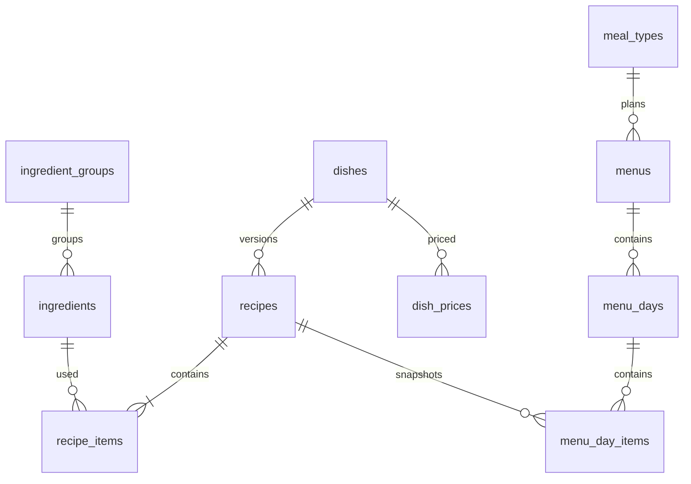

# Mô hình dữ liệu miền MENU

**Draft: thiết kế BA để review; chưa duyệt nghiệp vụ, chưa triển khai phần mềm.**

| Phiên bản | Ngày | Người thực hiện | Thay đổi |
| :--- | :--- | :--- | :--- |
| 0.1.0 | 2026-11-11 | BA | Bổ sung theo kế hoạch; giữ điểm mở và xác nhận đã có |

Nguồn vật lý duy nhất là [DBML tổng](../../nen-tang/srs/schema.dbml); không tạo schema copy dễ lệch. [ERD tổng mục4](../../nen-tang/srs/erd.md) chứa từ điển từng cột/enum/độ dài/khóa; bảng dưới ghi ownership và invariant để review API mới.

| Bảng | Ownership / invariant |
| :--- | :--- |
| ingredients / ingredient_groups / ingredient_seasons | MENU tạo, sửa; hệ số mua→dùng không phải grams_per_unit dinh dưỡng; không hủy khi được công thức hiệu lực dùng |
| dishes / cooking_methods / dish_allergens / dish_conflicts | Thuộc tính phục vụ rule; cặp kỵ unordered unique; baseDish dùng chống đổi tên để né lặp |
| recipes / recipe_items | VersionNo theo dish+portion; qty_min<=qty_std<=qty_max; ACTIVE không sửa; >=1 chính; ngày hiệu lực và version chụp |
| dish_prices | Giá bán gồmVAT, không phải ingredient_prices; chụp giá hiệu lực; trạng thái trả lại chờ MENU-API-Q02 |
| meal_types | Cơ cấu không đổi khi có menu từPENDING; sửa tên/public không tự đổi lịch sử cơ cấu |
| menus / menu_days / menu_day_items | Một tuần theo loại suất; phiên bản/menu-day snapshot recipe; default thuộc MAIN; ngày/món ngoài scope bị chặn |
| menu_rules / menu_rule_results | Rule thay đổi qua change_requests/approvals; kết quả theo rule version; detail Cost lọc quyền |

Import validation store, export jobs và idempotency store chưa có delta DB được duyệt (MENU-API-Q03/E1-Q02). Không coi các note DBML là CHECK đã được thực thi. Ghi menu/audit/cost snapshot theo transaction do MENU sở hữu, AIO không truy cập chéo bảng tùy ý.
