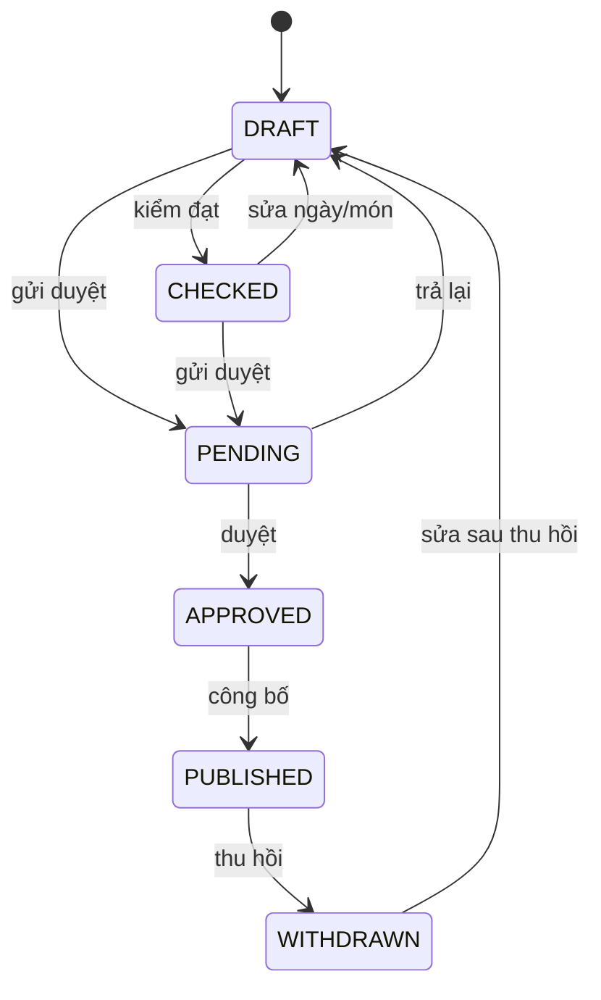

# Trạng thái — Thực đơn và định lượng

**Draft — thiết kế BA để review; chưa duyệt nghiệp vụ, chưa triển khai phần mềm.**

| Phiên bản | Ngày | Người thực hiện | Thay đổi |
| :--- | :--- | :--- | :--- |
| 0.1.0 | 2026-11-11 | BA | Bổ sung theo kế hoạch; giữ điểm mở và xác nhận đã có |

## Thực đơn tuần

| Hiện tại | Trigger | Guard | Đích | Actor |
| :--- | :--- | :--- | :--- | :--- |
| DRAFT | kiểm đạt | rule phù hợp | CHECKED | MENU |
| CHECKED | sửa ngày/món | quyền soạn+version | DRAFT | Dinh dưỡng viên |
| DRAFT | gửi duyệt | hard rule đạt và cổng Cost theo mode | PENDING | Dinh dưỡng viên |
| CHECKED | gửi duyệt | kiểm lại như DRAFT | PENDING | Dinh dưỡng viên |
| PENDING | trả lại | quyền+reason | DRAFT | Người duyệt |
| PENDING | duyệt | khác tạo/sửa cuối; đủ số người duyệt | APPROVED | Người duyệt |
| APPROVED | công bố | cổng MENU hiện hành | PUBLISHED | Người được cấp quyền |
| PUBLISHED | thu hồi | quyền+reason | WITHDRAWN | Người được cấp quyền |
| WITHDRAWN | sửa sau thu hồi | quyền+version | DRAFT | Dinh dưỡng viên |

Hủy DRAFT/CHECKED là cờ cancelled_at, không thêm enum CANCELLED. Công thức: DRAFT→PENDING→ACTIVE; trả lại→DRAFT; bản cũ→SUPERSEDED theo ngày hiệu lực. Món: DRAFT→PENDING→ACTIVE→INACTIVE; loại suất:DRAFT→ACTIVE→INACTIVE. Giá trả lại cần MENU-API-Q02; không tự gán trạng thái đã chốt.

Mọi transition ngoài bảng bị từ chối, không tự suy từ nút UI. Version cũ409; quyền thiếu403/ngoài scope404 theo SRS. Các quyền/số liệu chưa chốt giữ trong sổ câu hỏi, không coi state diagram là quyết định duyệt.
