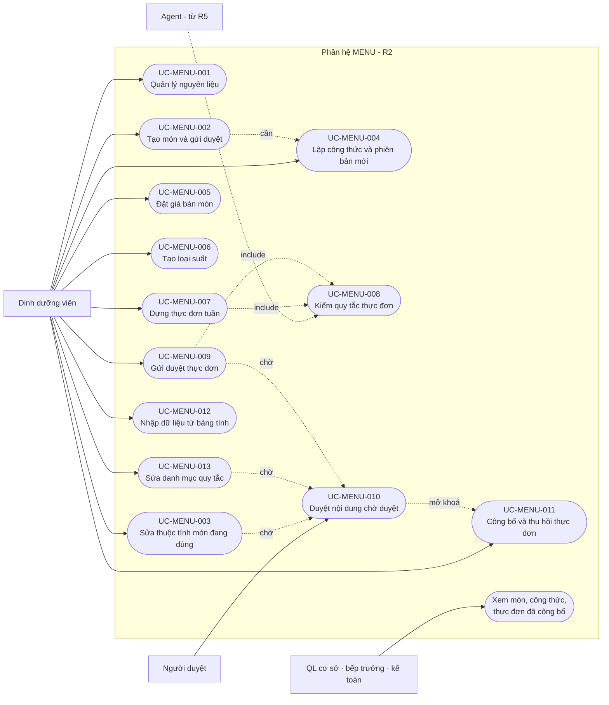

# Sơ đồ Use Case: Epic E2 · Thực đơn & Định lượng

## Metadata

| Trường | Giá trị |
| :--- | :--- |
| Template | `25-usecase-diagram.md` · BA-Kit v1.0 |
| Phiên bản | 0.1.0 |
| Trạng thái | Draft |
| Ngày | 2026-11-10 |
| Tài liệu liên quan | [SRS epic](spec.md) · [Epic-spec](../epic-spec.md) · [SRS nền tảng](../../nen-tang/srs/spec.md) |

## 1. Thông tin tổng quan

Sơ đồ cho biết ai làm được việc gì trong phân hệ MENU ở đợt R2, và các use case phụ thuộc nhau thế nào. Mermaid không có kiểu sơ đồ use case riêng nên sơ đồ dùng `flowchart`: hình bầu dục là use case, hình chữ nhật là tác nhân, mũi tên nét đứt là quan hệ `include`.

## 2. Tác nhân

| Tác nhân | Loại | Vai trò hệ thống | Ghi chú |
| :--- | :--- | :--- | :--- |
| Dinh dưỡng viên (A-06) | Chính | `DINH_DUONG_VIEN` | Người tạo mọi nội dung của phân hệ |
| Người duyệt | Chính | `GIAM_DOC`, hoặc người được uỷ quyền | Ai giữ vai trò này: [O-06] |
| Quản lý cơ sở, bếp trưởng, kế toán (A-07, A-08, A-09) | Hỗ trợ | `QL_CO_SO`, `BEP_TRUONG`, `KT_*` | Chỉ xem |
| Agent Nội bộ, Agent Dinh dưỡng viên (A-12, A-11) | Hệ thống | Tài khoản dịch vụ | Gọi `UC-MENU-008` từ R5, R9; ngoài phạm vi R2 |
| Bộ hẹn giờ (A-13) | Hệ thống | Không áp dụng | Chuyển công thức cũ sang `SUPERSEDED` vào ngày hiệu lực |

## 3. Sơ đồ

## 4. Danh mục use case

| Mã | Tên | Cấp độ | Tác nhân chính | FR chính | File |
| :--- | :--- | :--- | :--- | :--- | :--- |
| `UC-MENU-001` | Quản lý nguyên liệu | Sea | Dinh dưỡng viên | `FR-MENU-ING-001` → `006` | [UC-MENU-001](../usecases/UC-MENU-001.md) |
| `UC-MENU-002` | Tạo món và gửi duyệt | Sea | Dinh dưỡng viên | `FR-MENU-DISH-001`, `003`, `007`, `008` | [UC-MENU-002](../usecases/UC-MENU-002.md) |
| `UC-MENU-003` | Sửa thuộc tính món đang dùng | Sea | Dinh dưỡng viên | `FR-MENU-DISH-002`, `005` | [UC-MENU-003](../usecases/UC-MENU-003.md) |
| `UC-MENU-004` | Lập công thức và phiên bản mới | Sea | Dinh dưỡng viên | `FR-MENU-RCP-001` → `006` | [UC-MENU-004](../usecases/UC-MENU-004.md) |
| `UC-MENU-005` | Đặt giá bán món | Sea | Dinh dưỡng viên | `FR-MENU-PRC-001` → `004` | [UC-MENU-005](../usecases/UC-MENU-005.md) |
| `UC-MENU-006` | Tạo loại suất | Sea | Dinh dưỡng viên | `FR-MENU-MTY-001` → `004` | [UC-MENU-006](../usecases/UC-MENU-006.md) |
| `UC-MENU-007` | Dựng thực đơn tuần | Sea | Dinh dưỡng viên | `FR-MENU-MNU-001` → `009` | [UC-MENU-007](../usecases/UC-MENU-007.md) |
| `UC-MENU-008` | Kiểm quy tắc thực đơn | Fish | Hệ thống (được gọi) | `FR-MENU-RUL-001` → `004` | [UC-MENU-008](../usecases/UC-MENU-008.md) |
| `UC-MENU-009` | Gửi duyệt thực đơn | Sea | Dinh dưỡng viên | `FR-MENU-APV-001`, `006` | [UC-MENU-009](../usecases/UC-MENU-009.md) |
| `UC-MENU-010` | Duyệt nội dung chờ duyệt | Sea | Người duyệt | `FR-MENU-DISH-004`, `RCP-003`, `PRC-002`, `APV-002`, `RUL-006`, `007` | [UC-MENU-010](../usecases/UC-MENU-010.md) |
| `UC-MENU-011` | Công bố và thu hồi thực đơn | Sea | Dinh dưỡng viên | `FR-MENU-APV-003` → `005` | [UC-MENU-011](../usecases/UC-MENU-011.md) |
| `UC-MENU-012` | Nhập dữ liệu từ bảng tính | Sea | Dinh dưỡng viên | `FR-MENU-IMP-001` → `003` | [UC-MENU-012](../usecases/UC-MENU-012.md) |
| `UC-MENU-013` | Sửa danh mục quy tắc | Sea | Dinh dưỡng viên | `FR-MENU-RUL-005`, `006` | [UC-MENU-013](../usecases/UC-MENU-013.md) |

"Xem món, công thức, thực đơn đã công bố" là thao tác chỉ đọc (`FR-MENU-ING-004`, `DISH-006`, `MNU-007`), không viết use case riêng.

## 5. Chuỗi use case điển hình

Lần đầu đưa một món mới vào thực đơn tuần:

`UC-MENU-001` (nguyên liệu) → `UC-MENU-002` (món) + `UC-MENU-004` (công thức) → `UC-MENU-010` (duyệt món và công thức) → `UC-MENU-005` (giá bán) → `UC-MENU-010` (duyệt giá) → `UC-MENU-007` (dựng thực đơn, có `UC-MENU-008`) → `UC-MENU-009` (gửi duyệt) → `UC-MENU-010` (duyệt thực đơn) → `UC-MENU-011` (công bố).

Với dữ liệu ban đầu, `UC-MENU-012` thay cho bốn bước đầu.

## 6. Lịch sử sửa đổi

| Phiên bản | Ngày | Người thực hiện | Tóm tắt thay đổi |
| :--- | :--- | :--- | :--- |
| 0.1.0 | 2026-11-10 | BA | Khởi tạo |
