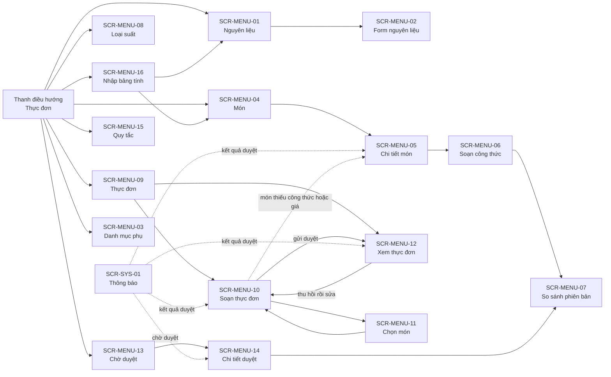
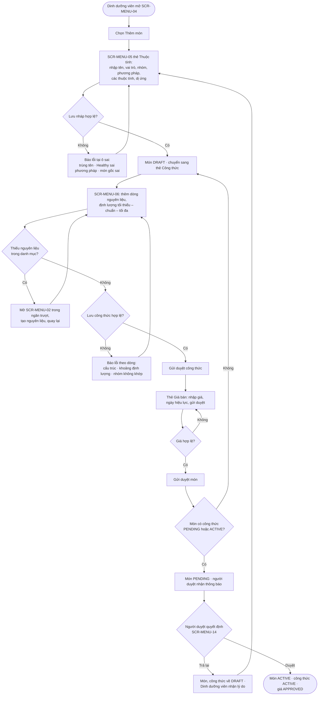
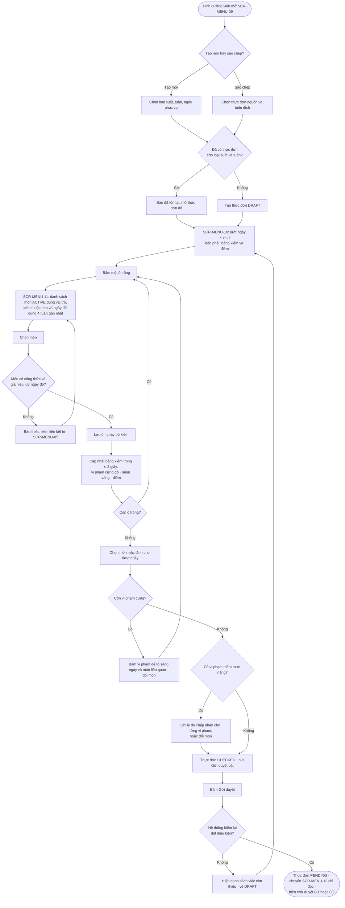
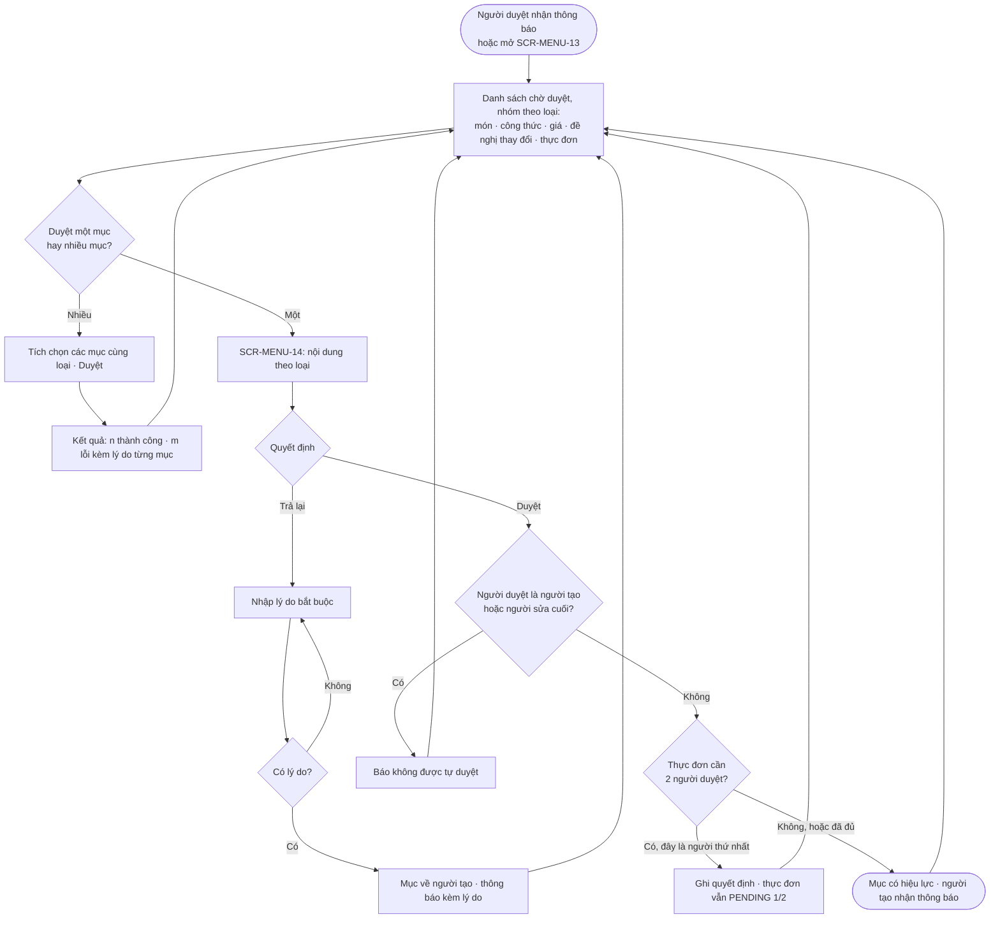
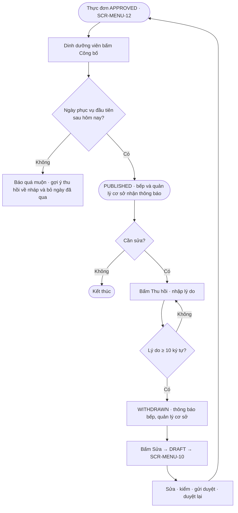
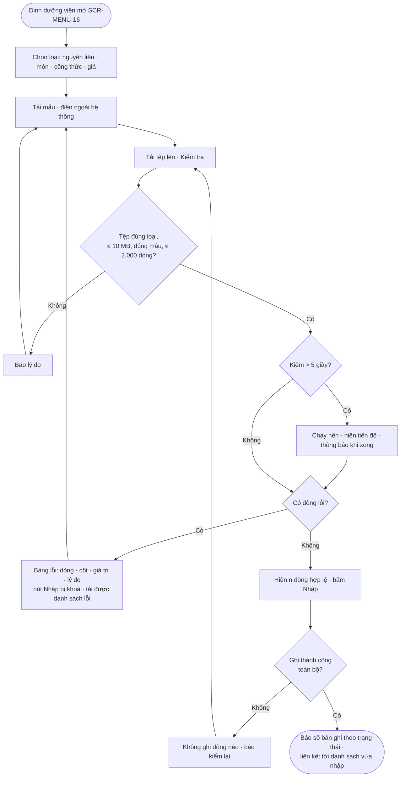
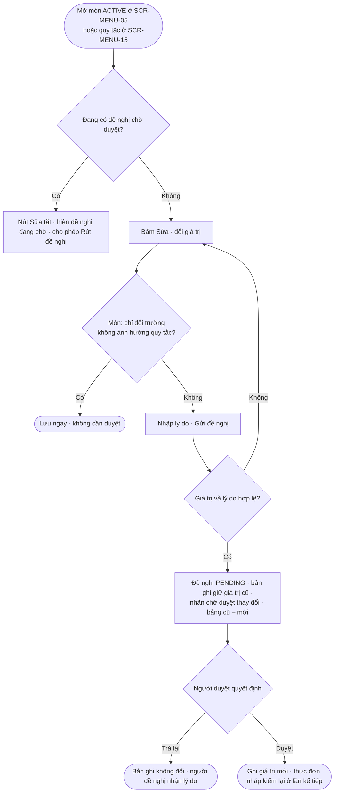

# Luồng người dùng (User Flow): Epic E2 · Thực đơn & Định lượng

## Metadata

| Trường | Giá trị |
| :--- | :--- |
| Template | `29-user-flow.md` · BA-Kit v1.0 |
| Phiên bản | 0.1.0 |
| Trạng thái | Draft |
| Ngày | 2026-11-10 |
| Mặt tiền | Trang quản trị nội bộ: `admin.comgiaphat.com` |
| Tài liệu liên quan | [SRS epic](../srs/spec.md) · [Sơ đồ use case](../srs/usecase-diagram.md) · [Epic-spec](../epic-spec.md) |

Quy ước: **[ĐỀ XUẤT]** chờ duyệt · **[O-xx] / [E2-Qx]** điểm mở, giữ nguyên trạng thái mở. Tên màn hình, đường dẫn và cách bố trí là [ĐỀ XUẤT]; chưa có buổi làm việc nào với người dùng thật về giao diện.

---

## 1. Thông tin tổng quan

Tài liệu mô tả người dùng đi qua những màn hình nào để hoàn thành 13 use case của epic, mỗi màn hình có những trạng thái nào, và mỗi luồng rẽ nhánh ra sao khi có lỗi hoặc tình huống biên. Đây là đầu vào cho bước `/wireframe-html`.

Người dùng của epic: Dinh dưỡng viên (tạo), Người duyệt (duyệt), và quản lý cơ sở, bếp trưởng, kế toán (xem).

---

## 2. Danh mục màn hình

| Mã | Màn hình | Đường dẫn | Ai dùng | Use case | Thao tác chính |
| :--- | :--- | :--- | :--- | :--- | :--- |
| `SCR-MENU-01` | Danh sách nguyên liệu | `/menu/ingredients` | Tất cả vai trò nội bộ | `UC-MENU-001` | Tìm, lọc, thêm, mở chi tiết |
| `SCR-MENU-02` | Form nguyên liệu (ngăn trượt) | `/menu/ingredients/:id` | Dinh dưỡng viên | `UC-MENU-001` | Tạo, sửa, ngừng dùng, khai mùa vụ |
| `SCR-MENU-03` | Danh mục phụ | `/menu/settings` | Dinh dưỡng viên | `UC-MENU-001`, `002` | 4 thẻ: nhóm nguyên liệu · phương pháp chế biến · chất gây dị ứng · cặp món kỵ |
| `SCR-MENU-04` | Danh sách món | `/menu/dishes` | Tất cả vai trò nội bộ | `UC-MENU-002`, `003` | Tìm, lọc theo vai trò / nhóm / phương pháp / trạng thái, thêm, gửi duyệt hàng loạt |
| `SCR-MENU-05` | Chi tiết món | `/menu/dishes/:id` | Tất cả; sửa: Dinh dưỡng viên | `UC-MENU-002`, `003`, `005` | 4 thẻ: Thuộc tính · Công thức · Giá bán · Lịch sử thay đổi |
| `SCR-MENU-06` | Soạn công thức | `/menu/dishes/:id/recipes/:rid` | Dinh dưỡng viên | `UC-MENU-004` | Thêm dòng nguyên liệu, nhập định lượng, lưu nháp, gửi duyệt, tạo phiên bản mới |
| `SCR-MENU-07` | So sánh phiên bản công thức | `/menu/dishes/:id/recipes/compare` | Dinh dưỡng viên, Người duyệt | `UC-MENU-004`, `010` | Xem dòng thêm, bớt, đổi |
| `SCR-MENU-08` | Loại suất | `/menu/meal-types` | Dinh dưỡng viên | `UC-MENU-006` | Danh sách + form: tạo, kích hoạt, ngừng |
| `SCR-MENU-09` | Danh sách thực đơn | `/menu/menus` | Tất cả vai trò nội bộ | `UC-MENU-007`, `011` | Lọc theo loại suất, tuần, trạng thái; tạo; sao chép |
| `SCR-MENU-10` | Soạn thực đơn tuần | `/menu/menus/:id/edit` | Dinh dưỡng viên | `UC-MENU-007`, `008`, `009` | Lưới ngày × vị trí; bảng kiểm quy tắc; chọn món mặc định; gửi duyệt |
| `SCR-MENU-11` | Hộp chọn món | (hộp thoại trên `SCR-MENU-10`) | Dinh dưỡng viên | `UC-MENU-007` | Tìm món theo vai trò của ô; xem thuộc tính và lịch sử 4 tuần |
| `SCR-MENU-12` | Xem thực đơn | `/menu/menus/:id` | Tất cả vai trò nội bộ | `UC-MENU-011` | Chỉ đọc; công bố; thu hồi; xuất PDF |
| `SCR-MENU-13` | Chờ duyệt | `/approvals` | Người duyệt | `UC-MENU-010` | Danh sách theo loại; duyệt hàng loạt |
| `SCR-MENU-14` | Chi tiết duyệt | `/approvals/:type/:id` | Người duyệt | `UC-MENU-010` | Xem nội dung theo loại; duyệt; trả lại kèm lý do |
| `SCR-MENU-15` | Danh mục quy tắc | `/menu/rules` | Dinh dưỡng viên, Người duyệt | `UC-MENU-013` | Xem; đề nghị sửa |
| `SCR-MENU-16` | Nhập từ bảng tính | `/menu/import` | Dinh dưỡng viên | `UC-MENU-012` | Tải mẫu, tải tệp, kiểm tra, xem lỗi, nhập |
| `SCR-SYS-01` | Trung tâm thông báo | (thanh trên cùng) | Tất cả | Chưa có | Thuộc epic nền tảng; là lối vào `SCR-MENU-13`, `14` và các màn hình chi tiết |

Vai trò chỉ có quyền xem thấy `SCR-MENU-01`, `04`, `05` (không có nút sửa), `09` và `12` (chỉ thực đơn đã công bố). Người không có quyền mở đường dẫn khác nhận `ERR-AUTH-403-02`.

---

## 3. Bản đồ điều hướng

---

## 4. Các luồng

Mỗi luồng có một sơ đồ và một bảng phủ tình huống. Ký hiệu trong bảng: **H** = luồng thuận lợi · **E** = lỗi · **B** = tình huống biên.

### 4.1 F1: Đưa một món mới vào danh mục

Use case: `UC-MENU-001`, `002`, `004`, `005`, `010`.

| # | Loại | Tình huống | Hệ thống phản hồi | Tham chiếu |
| :--- | :---: | :--- | :--- | :--- |
| F1-01 | H | Tạo món, công thức, giá; duyệt cả ba | Món chọn được khi xếp thực đơn từ ngày giá và công thức có hiệu lực | `UC-MENU-002` luồng chính |
| F1-02 | E | Tên món trùng | Lỗi tại ô tên, kèm liên kết tới món trùng | `ERR-MENU-409-01` |
| F1-03 | E | Gắn Healthy với phương pháp không ít dầu mỡ | Lỗi tại ô Healthy, nêu phương pháp hiện tại | `ERR-MENU-422-04` |
| F1-04 | E | Món gốc sai | Lỗi tại ô món gốc | `ERR-MENU-422-05` |
| F1-05 | E | Công thức không có nguyên liệu chính, hoặc lặp nguyên liệu | Lỗi phía trên bảng dòng | `ERR-MENU-422-08` |
| F1-06 | E | Định lượng tối thiểu > chuẩn hoặc chuẩn > tối đa | Lỗi tại dòng sai | `ERR-MENU-422-09` |
| F1-07 | E | Nguyên liệu chính không thuộc nhóm của món | Lỗi nêu tên nhóm cần có | `ERR-MENU-422-10` |
| F1-08 | E | Giá không phải bội số 100 đồng, hoặc ngày hiệu lực không sau hôm nay | Lỗi tại ô giá / ô ngày | `ERR-MENU-422-11` |
| F1-09 | E | Gửi duyệt món chưa có công thức | Thông báo và chuyển sang thẻ Công thức | `ERR-MENU-422-06` |
| F1-10 | B | Cần nguyên liệu chưa có trong danh mục khi đang soạn công thức | Tạo nguyên liệu trong ngăn trượt mà không mất các dòng đã nhập | `UC-MENU-001` |
| F1-11 | B | Người duyệt chỉ duyệt công thức, trả lại món | Công thức `ACTIVE`, món `DRAFT`; sửa món rồi gửi lại, không cần gửi lại công thức | `UC-MENU-010` 4a |
| F1-12 | B | Duyệt món và công thức đầu tiên trong cùng một lần | Được phép; hệ thống duyệt công thức trước, món sau | `BR-CAT-009` |
| F1-13 | B | Rời màn hình khi form có thay đổi chưa lưu | Hộp xác nhận "Bỏ thay đổi chưa lưu?" | [ĐỀ XUẤT] |
| F1-14 | B | Người khác vừa sửa cùng món | Thông báo tải lại; giữ giá trị người dùng vừa nhập để đối chiếu | `ERR-SYS-409-02` |

### 4.2 F2: Dựng và gửi duyệt thực đơn tuần

Use case: `UC-MENU-007`, `008`, `009`. Đây là luồng chính của epic.

| # | Loại | Tình huống | Hệ thống phản hồi | Tham chiếu |
| :--- | :---: | :--- | :--- | :--- |
| F2-01 | H | Xếp đủ món, không vi phạm, gửi duyệt | Thực đơn `PENDING`, người duyệt nhận thông báo | `UC-MENU-007`, `009` luồng chính |
| F2-02 | E | Tuần không bắt đầu thứ Hai, không chọn ngày nào | Lỗi tại form tạo | `ERR-MENU-422-13` |
| F2-03 | E | Đã có thực đơn cho loại suất và tuần | Thông báo và mở thực đơn đã có | `ERR-MENU-409-06` |
| F2-04 | E | Chọn món không còn `ACTIVE` (bị ngừng trong lúc hộp chọn đang mở) | Thông báo, làm mới danh sách | `ERR-MENU-422-14` |
| F2-05 | E | Món không có công thức hiệu lực ngày phục vụ | Thông báo kèm liên kết tới thẻ Công thức của món | `ERR-MENU-404-01` |
| F2-06 | E | Món không có giá bán hiệu lực ngày phục vụ | Thông báo kèm liên kết tới thẻ Giá bán của món | `ERR-MENU-404-02` |
| F2-07 | E | Gửi duyệt khi còn ô trống hoặc thiếu món mặc định | Danh sách việc còn thiếu, tô sáng ô | `ERR-MENU-422-17` |
| F2-08 | E | Gửi duyệt khi còn vi phạm cứng | Số vi phạm, cuộn tới bảng kiểm | `ERR-MENU-422-18` |
| F2-09 | E | Gửi duyệt khi vi phạm mềm mức nặng chưa có lý do | Tô sáng các vi phạm thiếu lý do | `ERR-MENU-422-19` |
| F2-10 | E | Tổng giá một tổ hợp vượt ngưỡng giá loại suất | Vi phạm `BR-COST-012` trong bảng kiểm, nêu món chính nào vượt và vượt bao nhiêu | `FR-MENU-MNU-004`; [E2-Q1] |
| F2-11 | B | Sao chép từ tuần có món đã ngừng dùng | Ô đó để trống; dải thông báo liệt kê món bị bỏ | `UC-MENU-007` A1 |
| F2-12 | B | Đổi món làm một vi phạm mềm mức nặng hết | Lý do chấp nhận đã ghi tự xoá | `UC-MENU-008` 9a |
| F2-13 | B | Bỏ món đang là mặc định | Món mặc định của ngày bị xoá; thực đơn về `DRAFT`; ngày đó hiện nhãn "chưa có món mặc định" | `UC-MENU-007` 9b |
| F2-14 | B | Sửa thực đơn `CHECKED` làm phát sinh vi phạm cứng | Trạng thái về `DRAFT`; nút Gửi duyệt tắt | `UC-MENU-007` 10a |
| F2-15 | B | Quy tắc tuần xét ngày của tuần trước nhưng tuần trước chưa có thực đơn | Chỉ tính trong tuần hiện tại; bảng kiểm ghi chú "không có dữ liệu tuần trước" | `UC-MENU-008` 3a; [E2-Q2] |
| F2-16 | B | Chưa có món `ACTIVE` nào cho một vai trò | Hộp chọn món hiện trạng thái rỗng kèm liên kết tạo món | Không áp dụng |
| F2-17 | B | Bộ kiểm chưa trả kết quả sau 2 giây | Bảng kiểm hiện "đang kiểm"; nút Gửi duyệt tắt cho đến khi có kết quả | `NFR-MENU-001` |
| F2-18 | B | Hai người cùng sửa một thực đơn | Người lưu sau nhận thông báo tải lại | `ERR-SYS-409-02` |
| F2-19 | B | Màn hình hẹp hơn 768 px | Lưới chuyển thành xem từng ngày, vuốt ngang để đổi ngày; bảng kiểm thành ngăn kéo từ dưới lên | `NFR-USE-001`; [ĐỀ XUẤT] |

### 4.3 F3: Duyệt

Use case: `UC-MENU-010`.

| # | Loại | Tình huống | Hệ thống phản hồi | Tham chiếu |
| :--- | :---: | :--- | :--- | :--- |
| F3-01 | H | Duyệt một mục | Mục có hiệu lực; biến mất khỏi danh sách chờ | `UC-MENU-010` luồng chính |
| F3-02 | H | Duyệt nhiều mục cùng loại | Báo số thành công và số lỗi | `UC-MENU-010` 4b |
| F3-03 | E | Trả lại không có lý do | Lỗi tại ô lý do | `ERR-SYS-422-01` |
| F3-04 | E | Tự duyệt nội dung của mình | Nút Duyệt tắt kèm chú giải; nếu gọi trực tiếp thì báo lỗi | `ERR-SYS-403-01` |
| F3-05 | E | Duyệt món chưa có công thức `ACTIVE` | Báo lỗi, gợi ý duyệt công thức trước hoặc cùng lúc | `ERR-MENU-422-06` |
| F3-06 | E | Uỷ quyền hết hạn trong lúc đang xem | Báo không có quyền | `ERR-AUTH-403-02` |
| F3-07 | B | Thực đơn cần 2 người duyệt | Sau người thứ nhất: nhãn "đã duyệt 1/2"; người đó không duyệt lần hai được | `BR-MNU-008` |
| F3-08 | B | Mục đã được người khác xử lý | Thông báo và tải lại trạng thái | `ERR-SYS-409-02` |
| F3-09 | B | Đề nghị thay đổi đã lỗi thời | Nhãn "lỗi thời"; không duyệt được; người đề nghị được báo gửi lại | `UC-MENU-010` 7c |
| F3-10 | B | Không có gì chờ duyệt | Trạng thái rỗng: "Không có nội dung chờ duyệt" | Không áp dụng |
| F3-11 | B | Duyệt công thức phiên bản mới | Màn hình hiện so sánh với phiên bản đang hiệu lực (`SCR-MENU-07`) | `UC-MENU-004` A5 |
| F3-12 | B | Duyệt thực đơn có cảnh báo | Mỗi cảnh báo mức nặng hiện kèm lý do chấp nhận của người dựng | `BR-MNU-006` |

### 4.4 F4: Công bố, thu hồi, sửa lại

Use case: `UC-MENU-011`.

| # | Loại | Tình huống | Hệ thống phản hồi | Tham chiếu |
| :--- | :---: | :--- | :--- | :--- |
| F4-01 | H | Công bố thực đơn đã duyệt | Thực đơn hiện với mọi vai trò có quyền xem | `UC-MENU-011` luồng chính |
| F4-02 | E | Công bố khi ngày đầu tiên là hôm nay hoặc đã qua | Báo lỗi kèm gợi ý | `ERR-MENU-409-09` |
| F4-03 | E | Thu hồi không có lý do | Lỗi tại ô lý do | `ERR-SYS-422-01` |
| F4-04 | B | Thu hồi khi một số ngày của tuần đã phục vụ | R2: vẫn thu hồi cả tuần. Cách xử lý theo ngày: [E2-Q8] | `UC-MENU-011` |
| F4-05 | B | Sửa lại sau thu hồi khi thuộc tính món hoặc quy tắc đã đổi | Kết quả kiểm tính lại theo giá trị hiện hành; có thể phát sinh vi phạm mới | `UC-MENU-011` A2 |
| F4-06 | B | Vai trò chỉ xem mở thực đơn chưa công bố bằng đường dẫn trực tiếp | "Không tìm thấy dữ liệu" | `ERR-SYS-404-01` |
| F4-07 | B | Xuất PDF thực đơn chưa công bố | Tệp có dòng "BẢN NHÁP: CHƯA CÔNG BỐ" ở đầu mỗi trang | [ĐỀ XUẤT] |

### 4.5 F5: Nhập dữ liệu gốc từ bảng tính

Use case: `UC-MENU-012`.

| # | Loại | Tình huống | Hệ thống phản hồi | Tham chiếu |
| :--- | :---: | :--- | :--- | :--- |
| F5-01 | H | Tệp sạch, nhập thành công | Số bản ghi theo trạng thái; liên kết tới danh sách đã lọc theo lần nhập | `UC-MENU-012` luồng chính |
| F5-02 | E | Tệp vượt 10 MB hoặc sai định dạng | Báo ngay khi chọn tệp | `ERR-SYS-413-01`, `ERR-SYS-415-01` |
| F5-03 | E | Sai mẫu hoặc vượt 2.000 dòng | Nêu cột thiếu hoặc số dòng | `ERR-MENU-422-20` |
| F5-04 | E | Có dòng lỗi | Bảng lỗi theo dòng; không nhập được | `ERR-MENU-422-20` |
| F5-05 | B | Nhập công thức trước khi nhập món | Mỗi dòng báo "không tìm thấy món"; đầu màn hình nhắc thứ tự nhập | `UC-MENU-012` 4c |
| F5-06 | B | Hai dòng trong tệp trùng tên nhau | Cả hai dòng bị đánh dấu lỗi | `UC-MENU-012` bước 4 |
| F5-07 | B | Dòng trùng bản ghi đã có | Lỗi; không tự cập nhật. Có cần nhập cập nhật: [E2-Q10] | `UC-MENU-012` 4d |
| F5-08 | B | Rời trang khi đang kiểm nền | Việc kiểm tiếp tục; kết quả mở lại được từ thông báo | `NFR-MENU-003` |
| F5-09 | B | Dữ liệu hệ thống đổi giữa lúc kiểm và lúc nhập | Không ghi gì; yêu cầu kiểm lại | `UC-MENU-012` 7a |

### 4.6 F6: Sửa món đang dùng và sửa quy tắc

Use case: `UC-MENU-003`, `013`. Hai luồng cùng một mẫu: đề nghị → duyệt → áp dụng.

| # | Loại | Tình huống | Hệ thống phản hồi | Tham chiếu |
| :--- | :---: | :--- | :--- | :--- |
| F6-01 | H | Đề nghị sửa, được duyệt | Giá trị mới có hiệu lực | `UC-MENU-003` A1, `UC-MENU-013` A1 |
| F6-02 | H | Sửa tên, mô tả, ảnh, dị ứng của món | Lưu ngay, không qua duyệt | `UC-MENU-003` 1a |
| F6-03 | E | Thiếu lý do | Lỗi tại ô lý do | `ERR-SYS-422-01` |
| F6-04 | E | Giá trị quy tắc không hợp lệ | Lỗi tại ô sai | `ERR-MENU-422-16` |
| F6-05 | E | Ngừng dùng món đang ở thực đơn đã công bố sắp phục vụ | Báo lỗi kèm danh sách thực đơn | `ERR-SYS-409-01` |
| F6-06 | B | Bản ghi đã có đề nghị chờ duyệt | Không tạo đề nghị thứ hai; cho rút đề nghị cũ | `UC-MENU-003` tiền điều kiện |
| F6-07 | B | Quy tắc mới làm thực đơn `CHECKED` có vi phạm cứng | Thực đơn về `DRAFT` ở lần kiểm kế tiếp; danh sách thực đơn hiện nhãn "cần kiểm lại" | `UC-MENU-013` A1.2 |
| F6-08 | B | Thực đơn đang chờ duyệt hoặc đã duyệt | Giữ kết quả cũ | [E2-Q11] |

---

## 5. Trạng thái màn hình

Áp dụng chung cho mọi màn hình, trừ khi bảng dưới ghi khác:

| Trạng thái | Hành vi chung |
| :--- | :--- |
| Đang tải | Khung xương (skeleton) đúng bố cục; không hiện vòng xoay toàn trang |
| Lỗi tải | Thông báo trong vùng nội dung kèm nút "Thử lại" và mã yêu cầu (`requestId`) |
| Mất kết nối | Dải thông báo "Mất kết nối" ở đầu trang; các nút ghi bị tắt; dữ liệu đã nhập trên form được giữ; tự thử lại khi có mạng. Không hỗ trợ làm việc ngoại tuyến |
| Không có quyền | Trang "Bạn không có quyền" (`ERR-AUTH-403-02`) hoặc "Không tìm thấy dữ liệu" (`ERR-SYS-404-01`) |

| Màn hình | Bình thường | Rỗng | Trạng thái riêng |
| :--- | :--- | :--- | :--- |
| `SCR-MENU-01` Nguyên liệu | Bảng phân trang 20 dòng; lọc nhóm, loại bảo quản, trạng thái | "Chưa có nguyên liệu" + nút Thêm + liên kết Nhập từ bảng tính | Lọc không ra kết quả: "Không có nguyên liệu khớp bộ lọc" + nút Xoá lọc |
| `SCR-MENU-02` Form nguyên liệu | Ô hao hụt chỉ hiện khi tích "có xương/vỏ" | Không áp dụng | Nguyên liệu đang dùng trong công thức: ô đơn vị và hệ số bị khoá kèm chú giải số công thức |
| `SCR-MENU-04` Món | Bảng có cột vai trò, nhóm, phương pháp, Healthy, trạng thái | "Chưa có món" + nút Thêm + liên kết Nhập | Món có đề nghị chờ duyệt: nhãn "chờ duyệt thay đổi" |
| `SCR-MENU-05` Chi tiết món | 4 thẻ | Thẻ Công thức rỗng: "Món chưa có công thức" + nút Thêm. Thẻ Giá rỗng: "Món chưa có giá bán" | Vai trò chỉ xem: không có nút sửa; thẻ Giá ẩn với `QL_CO_SO`, `BEP_TRUONG` |
| `SCR-MENU-06` Soạn công thức | Bảng dòng; đơn vị tự điền | 1 dòng trống sẵn | Công thức không phải nháp: chỉ đọc + nút "Tạo phiên bản mới" |
| `SCR-MENU-08` Loại suất | Danh sách thẻ | "Chưa có loại suất" + nút Thêm | Loại suất đã có thực đơn gửi duyệt: các ô cơ cấu bị khoá kèm chú giải |
| `SCR-MENU-09` Thực đơn | Bảng theo tuần; nhãn trạng thái và điểm | "Chưa có thực đơn" + nút Tạo | Vai trò chỉ xem: chỉ thấy thực đơn đã công bố |
| `SCR-MENU-10` Soạn thực đơn | Lưới + bảng kiểm | Mọi ô trống; bảng kiểm ghi "Xếp món để bắt đầu kiểm" | Đang kiểm: bảng kiểm hiện "đang kiểm", giữ kết quả cũ mờ đi. Mất kết nối: khoá lưới |
| `SCR-MENU-11` Chọn món | Danh sách có ô tìm | "Chưa có món đang dùng cho vị trí này" + liên kết tạo món | Món đã có trong ngày: hiện mờ, không chọn được |
| `SCR-MENU-12` Xem thực đơn | Lưới chỉ đọc + bảng kiểm đã đóng băng | Không áp dụng | Nút theo trạng thái: `APPROVED` → Công bố; `PUBLISHED` → Thu hồi, Xuất PDF; `WITHDRAWN` → Sửa |
| `SCR-MENU-13` Chờ duyệt | Danh sách nhóm theo loại, có số đếm | "Không có nội dung chờ duyệt" | Không áp dụng |
| `SCR-MENU-14` Chi tiết duyệt | Nội dung + nút Duyệt, Trả lại | Không áp dụng | Người xem là người tạo: nút Duyệt tắt kèm chú giải. Đã xử lý: chỉ đọc |
| `SCR-MENU-15` Quy tắc | Bảng: mã, tên, loại, điểm phạt, phạm vi, tham số, bật/tắt | Không xảy ra (danh mục nạp sẵn) | Quy tắc có đề nghị chờ duyệt: nhãn và nút Sửa tắt |
| `SCR-MENU-16` Nhập | 3 bước: chọn loại → kiểm → nhập | Không áp dụng | Đang kiểm nền: thanh tiến độ. Có lỗi: bảng lỗi + nút tải danh sách lỗi |

---

## 6. Ma trận phủ

| Use case | Luồng | Màn hình | Số tình huống H / E / B |
| :--- | :--- | :--- | :--- |
| `UC-MENU-001` | F1 (nhánh tạo nguyên liệu) | `SCR-MENU-01`, `02`, `03` | Phủ trong F1-10 và bảng trạng thái |
| `UC-MENU-002` | F1 | `SCR-MENU-04`, `05` | 1 / 8 / 5 (chung F1) |
| `UC-MENU-003` | F6 | `SCR-MENU-05` | 2 / 3 / 3 (chung F6) |
| `UC-MENU-004` | F1 | `SCR-MENU-06`, `07` | Chung F1 |
| `UC-MENU-005` | F1 | `SCR-MENU-05` thẻ Giá | Chung F1 |
| `UC-MENU-006` | Không áp dụng | `SCR-MENU-08` | Phủ ở bảng trạng thái; luồng là một form đơn |
| `UC-MENU-007`, `008`, `009` | F2 | `SCR-MENU-09`, `10`, `11` | 1 / 9 / 9 |
| `UC-MENU-010` | F3 | `SCR-MENU-13`, `14` | 2 / 4 / 6 |
| `UC-MENU-011` | F4 | `SCR-MENU-12` | 1 / 2 / 4 |
| `UC-MENU-012` | F5 | `SCR-MENU-16` | 1 / 3 / 5 |
| `UC-MENU-013` | F6 | `SCR-MENU-15` | Chung F6 |

Tổng: 6 luồng, 69 tình huống (8 thuận lợi, 29 lỗi, 32 biên), 16 màn hình của epic.

### 6.1 Mã lỗi không nằm trong 6 luồng (cập nhật theo SRS v0.3.0)

14 mã lỗi dưới đây phát sinh ở form đơn hoặc được giao diện chặn trước bằng cách khoá ô, nên không có nhánh riêng trong sơ đồ. Giao diện vẫn phải hiển thị được chúng khi máy chủ trả về.

| Mã lỗi | Màn hình | Giao diện chặn trước bằng cách | Khi máy chủ vẫn trả lỗi |
| :--- | :--- | :--- | :--- |
| `ERR-MENU-422-01` | `SCR-MENU-02` | Tự điền 1000 khi chọn cặp kg – g; không cho nhập số ≤ 0 | Lỗi tại ô hệ số |
| `ERR-MENU-422-02` | `SCR-MENU-02` | Ô hao hụt thành bắt buộc khi tích "có xương/vỏ" | Lỗi tại ô hao hụt |
| `ERR-MENU-422-03` | `SCR-MENU-02` | Chọn tháng từ danh sách 1–12 | Lỗi tại ô tháng |
| `ERR-MENU-409-02` | `SCR-MENU-02` | Khoá ô đơn vị và hệ số khi nguyên liệu đang dùng | Thông báo kèm số công thức |
| `ERR-MENU-422-07` | `SCR-MENU-03` | Món đã chọn ở ô A không hiện ở ô B | Lỗi tại ô món B |
| `ERR-MENU-409-03` | `SCR-MENU-06` | Công thức không phải nháp hiện chỉ đọc | Thông báo kèm nút "Tạo phiên bản mới" |
| `ERR-MENU-422-21` | `SCR-MENU-06` | Ô ngày hiệu lực không cho chọn ngày trước hôm nay và ngày không sau phiên bản hiện có | Lỗi tại ô ngày hiệu lực |
| `ERR-MENU-409-04` | `SCR-MENU-05` thẻ Giá | Không áp dụng | Lỗi tại ô ngày hiệu lực |
| `ERR-MENU-409-10` | `SCR-MENU-05` thẻ Giá | Giá đã hiệu lực không có nút sửa, huỷ | Thông báo kèm gợi ý đặt giá mới |
| `ERR-MENU-422-12` | `SCR-MENU-08` | Giới hạn giá trị nhập của từng ô | Lỗi tại ô sai |
| `ERR-MENU-409-05` | `SCR-MENU-08` | Khoá các ô cơ cấu khi đã có thực đơn gửi duyệt | Thông báo kèm nút "Tạo loại suất mới" |
| `ERR-MENU-422-15` | `SCR-MENU-10` | Chỉ cho chọn món mặc định trong các món chính của ngày | Thông báo trên lưới |
| `ERR-MENU-409-07` | `SCR-MENU-10` | Thực đơn không ở `DRAFT`/`CHECKED` mở bằng `SCR-MENU-12` chỉ đọc | Chuyển sang `SCR-MENU-12` kèm thông báo |
| `ERR-MENU-409-08` | `SCR-MENU-09`, `12` | Nút Huỷ chỉ hiện với thực đơn nháp | Thông báo |

Với bảng này, cả 33 mã `ERR-MENU` của SRS v0.3.0 đều có chỗ hiển thị trên giao diện.

---

## 7. Điểm mở ảnh hưởng giao diện

Giữ nguyên trạng thái mở.

| Mã | Điểm mở | Màn hình bị ảnh hưởng |
| :--- | :--- | :--- |
| O-02 | Một món một hay nhiều cỡ định lượng | `SCR-MENU-05`, `06`: thêm bộ chọn cỡ |
| O-06, E2-Q7 | Ai duyệt; người duyệt giá có khác người duyệt nghiệp vụ | `SCR-MENU-13`: mỗi người thấy những loại nào |
| E2-Q1 | Cách kiểm ngưỡng giá suất | `SCR-MENU-10`: có hiện giá từng tổ hợp trên lưới không |
| E2-Q3 | Tuần phục vụ gồm những ngày nào | `SCR-MENU-09`, `10`: số cột của lưới |
| E2-Q6 | Rút lại thực đơn đang chờ duyệt | `SCR-MENU-12`: có nút Rút lại không |
| E2-Q8 | Thu hồi theo từng ngày | `SCR-MENU-12`: nút Thu hồi ở cấp tuần hay cấp ngày |
| E2-Q9 | Tự công bố khi duyệt xong | `SCR-MENU-12`: có nút Công bố không |
| E2-Q10 | Nhập cập nhật | `SCR-MENU-16`: thêm chế độ cập nhật |
| Không áp dụng | Thiết bị dinh dưỡng viên và người duyệt thật sự dùng (máy tính hay điện thoại): URD đánh dấu cần phỏng vấn | Quyết định ưu tiên bố cục nào cho `SCR-MENU-10`, `13`, `14` |

## 8. Lịch sử sửa đổi

| Phiên bản | Ngày | Người thực hiện | Tóm tắt thay đổi |
| :--- | :--- | :--- | :--- |
| 0.1.0 | 2026-11-10 | BA | Khởi tạo |
