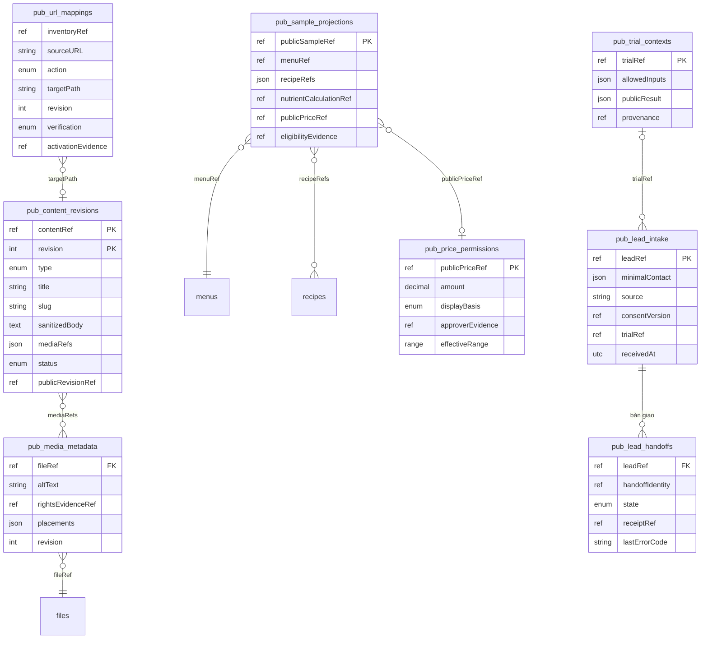

# ERD E8: kế thừa và delta đề xuất

Draft · 16/11/2026 · Thiết kế BA có điều kiện, chưa phê duyệt, chưa triển khai.

| Phiên bản | Ngày | Người thực hiện | Nội dung |
| :--- | :--- | :--- | :--- |
| 0.1.0 | 2026-11-16 | BA | Khởi tạo: vẽ quan hệ cho 8 thực thể delta trong từ điển dữ liệu E8. Không thêm thực thể hay trường |

Sơ đồ chỉ vẽ lại [delta dữ liệu E8](data-dictionary.md). **Schema chung giữ 65 bảng**; không chọn CMS, không DDL, không migration. Kiểu dữ liệu, độ dài, index, transaction và retention chờ E8-Q06, E8-Q08, E8-Q12. Không có bảng sức khỏe.

## 1. Sơ đồ

`files`, `menus`, `recipes` là bảng có sẵn trong [DBML tổng](../../nen-tang/srs/schema.dbml); `nutrientCalculationRef` trỏ tới delta E4 nên không vẽ thành bảng. Các bảng tiền tố `pub_` là delta. Khóa chính ghi PK là gợi ý theo trường tham chiếu trong từ điển, chưa phải quyết định thiết kế.

## 2. Ràng buộc cần review

| Nhóm | Ràng buộc | Căn cứ / gate |
| :--- | :--- | :--- |
| Nội dung | Con trỏ công khai chỉ trỏ revision được phép; sửa tạo revision mới, giữ bản công khai cũ; version chống ghi đè | BR-PUB-008/009; E8-Q08 |
| URL cũ | Một URL nguồn một quyết định trong mỗi revision mapping; không vòng lặp; đích phải công khai | BR-PUB-004; E8-Q01/02 |
| Thực đơn mẫu | Chỉ trường allowlist; ID nội bộ E2, E4 không ra client; thiếu chỉ số không thành 0 | BR-PUB-001/003; E8-Q04 |
| Giá công khai | Không lấy `price_cap` hay giá hợp đồng làm giá công khai | BR-PUB-002; E8-Q03 |
| Dựng thử | Không lưu hồ sơ người ăn hay dữ liệu sức khỏe; có lưu kết quả và thời hạn hay không chưa quyết | BR-PUB-005; E8-Q05/12 |
| Lead | Chỉ ghi khi có consent đúng phiên bản; không dùng `customers`, `eaters` làm lead; chưa receipt thì chưa là đã vào CRM | BR-PUB-006/007; E8-Q06/07/13 |
| Ảnh | Chỉ file được phép công khai; không lộ `storage_key` | E8-Q09 |
