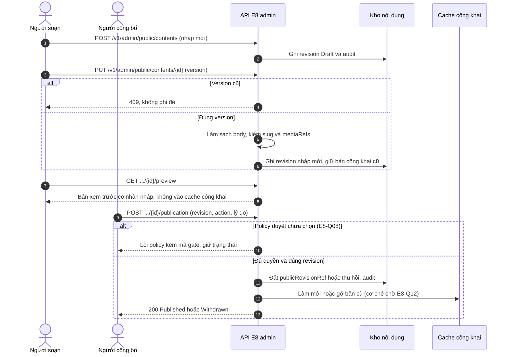
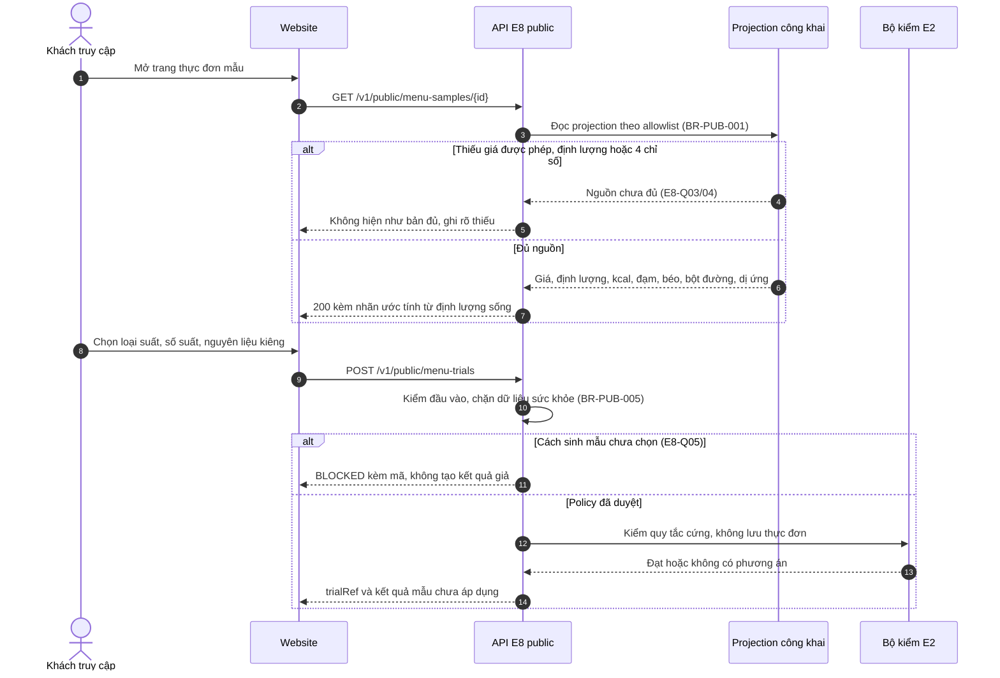
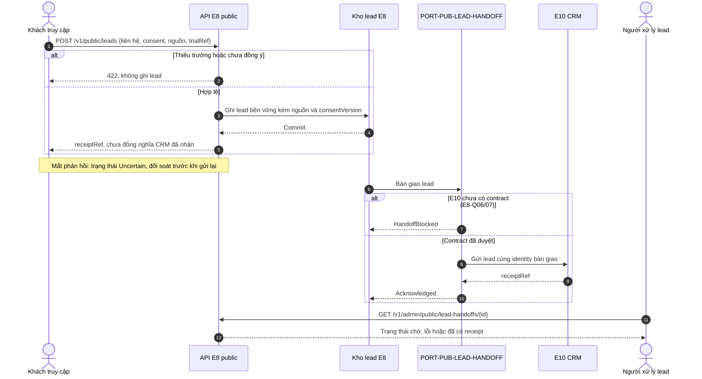
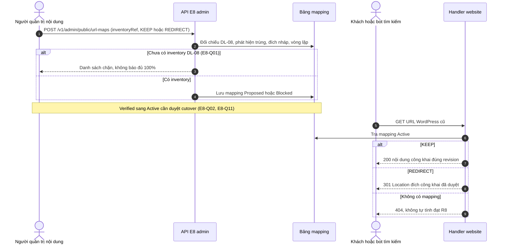

# Sơ đồ tuần tự E8: Website công khai

Draft · 16/11/2026 · Thiết kế BA có điều kiện, chưa phê duyệt, chưa triển khai.

| Phiên bản | Ngày | Người thực hiện | Nội dung |
| :--- | :--- | :--- | :--- |
| 0.1.0 | 2026-11-16 | BA | Khởi tạo: 4 sơ đồ tuần tự theo API-PUB và BR-PUB hiện có. Không thêm endpoint, mã lỗi hay quy tắc |

Route lấy từ [API E8](../api/api-spec.md); trạng thái lấy từ [states](states.md). CMS, cache, CDN và nơi lưu lead chưa chọn nên được vẽ là thành phần logic. Bước có gate ghi nhãn BLOCKED.

## 1. Soạn, xem trước và công bố nội dung (FEAT-059)

## 2. Xem thực đơn mẫu và dựng thử (FEAT-056, FEAT-057)

## 3. Gửi form tư vấn và bàn giao lead (FEAT-058)

## 4. Chuẩn bị và phục vụ URL cũ (FEAT-055)

Thứ tự ghi, chống gửi lặp cho khách ẩn danh và cơ chế làm mới cache là đề xuất; wire contract còn BLOCKED E8-Q12. Chưa có bằng chứng chạy.
