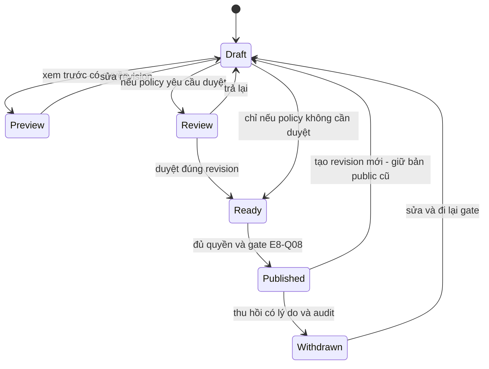
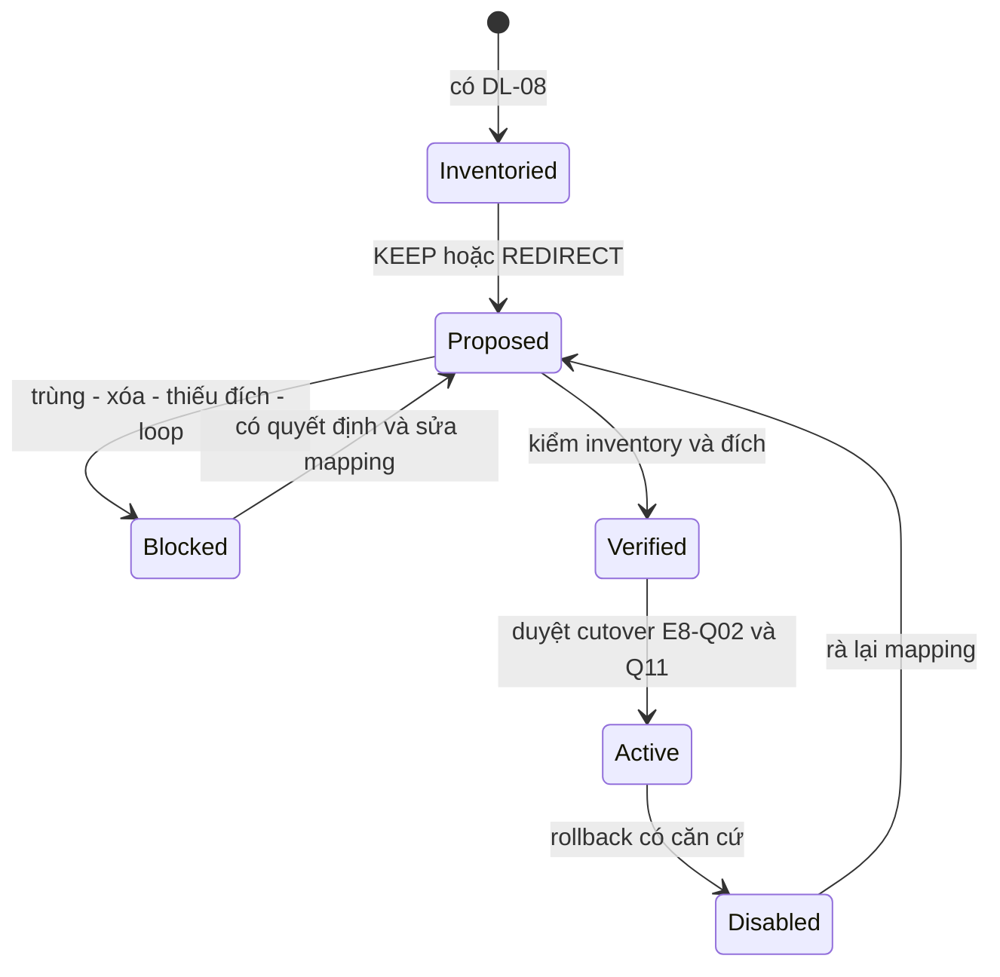
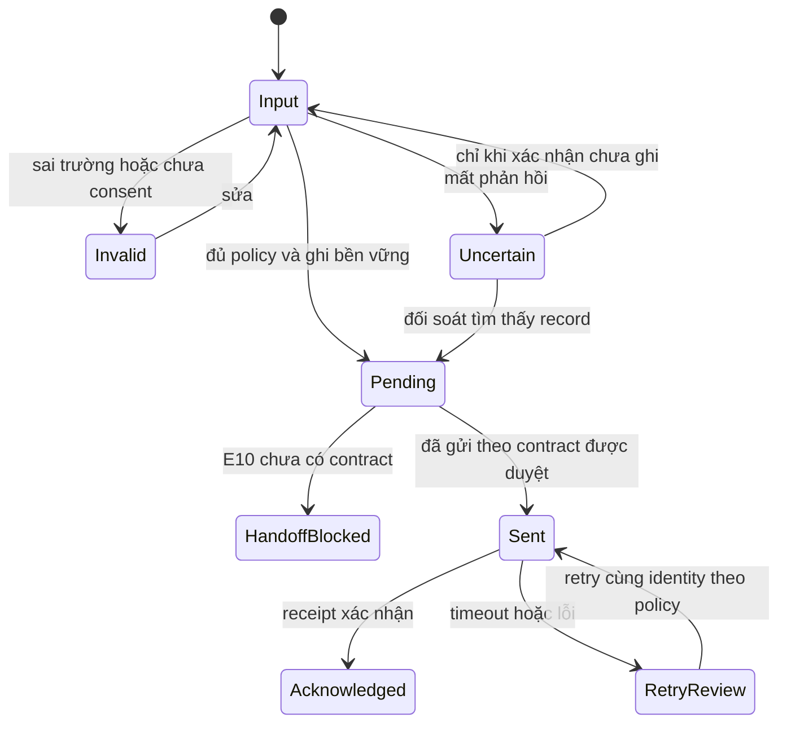

# Trạng thái nội dung, URL và lead

Draft · 12/11/2026 · Thiết kế có điều kiện, chưa phê duyệt; 0 backend/migration/UAT.

Tất cả state bên dưới là **đề xuất**, không tự chốt workflow E8-Q08 hay CRM E10. BLOCKED là kết quả preflight tài liệu, không bắt buộc enum DB.

## Nội dung / bài viết

Draft→Ready và Review chưa chọn; không chạy đồng thời như hai cách lách duyệt. Preview là trạng thái tương tác, không lưu thành trạng thái nghiệp vụ. Public pointer độc lập revision nháp; thu hồi invalidates cache theo E8-Q12.

## Chuyển hướng URL cũ

KEEP trả200 đúng bài, REDIRECT trả301; request GET không thay trạng thái. Verified không là đã cutover. R8 không tự miễn bài xóa khỏi mẫu số.

## Lead từ form

Input/Invalid/Uncertain là phía trình duyệt, không suy có record. Pending trở đi mới là lead đã lưu; Sent≠Acknowledged. Không định nghĩa các stage CRM. Notification có trạng thái độc lập, thất bại không xóa lead. E8-Q06/07/12 giữ chặn persistence/retry/retention.
