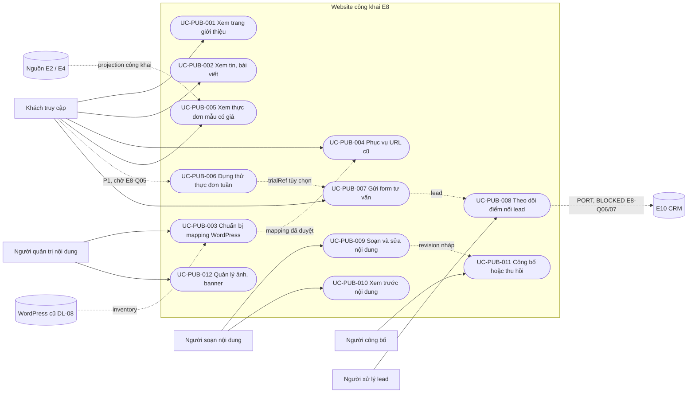

# Sơ đồ use case E8: Website công khai

Draft · 16/11/2026 · Thiết kế BA có điều kiện, chưa phê duyệt, chưa triển khai.

| Phiên bản | Ngày | Người thực hiện | Nội dung |
| :--- | :--- | :--- | :--- |
| 0.1.0 | 2026-11-16 | BA | Khởi tạo: sơ đồ actor và ma trận FR, UC, màn hình, API cho 12 UC hiện có. Không thêm FR hoặc UC |

File này chỉ vẽ lại phạm vi trong [SRS E8](spec.md), [danh mục UC](../usecases/index.md) và [màn hình](../ui/screens.md). Quyền soạn, duyệt, công bố chưa gán vai trò cụ thể (E8-Q08); tên tác nhân dưới đây là tên chức năng, không phải vai trò đã cấp.

## 1. Tác nhân

| Tác nhân | Loại | Ghi chú |
| :--- | :--- | :--- |
| Khách truy cập | Người, không đăng nhập | Xem trang, bài, thực đơn mẫu; dựng thử; gửi form |
| Người soạn nội dung | Người, AUTH nền | Soạn, sửa, xem trước; quyền chờ E8-Q08 |
| Người công bố | Người, AUTH nền | Công bố hoặc thu hồi; có bước duyệt hay không chờ E8-Q08 |
| Người quản trị nội dung | Người, AUTH nền | Mapping URL WordPress, ảnh và banner |
| Người xử lý lead | Người, AUTH nền | Theo dõi bàn giao lead; không mở phễu CRM E10 |
| WordPress cũ (DL-08) | Nguồn dữ liệu | Chỉ cung cấp inventory và bản xuất; không kết nối trực tiếp |
| Nguồn E2 / E4 | Hệ thống nội bộ | Thực đơn, công thức, dinh dưỡng; chưa freeze contract |
| E10 CRM | Hệ thống nhận | Chỉ qua PORT-PUB-LEAD-HANDOFF; chưa có contract |

## 2. Sơ đồ

Cạnh nét đứt là luồng dữ liệu hoặc gate. Khách không bao giờ thấy cost, giá nhập, chiết khấu hay dữ liệu khách nội bộ (BR-PUB-001). Dựng thử không ghi thực đơn, không gọi Agent E9.

## 3. Ma trận FR, UC, màn hình, API

| UC | FR | Feature | Tác nhân chính | Màn hình | API | Gate chính |
| :--- | :--- | :--- | :--- | :--- | :--- | :--- |
| [UC-PUB-001](../usecases/UC-PUB-001.md) | FR-PUB-PAGE-001 | FEAT-054 | Khách truy cập | UI-PUB-01 | API-PUB-001 | E8-Q08 |
| [UC-PUB-002](../usecases/UC-PUB-002.md) | FR-PUB-BLOG-001 | FEAT-055 | Khách truy cập | UI-PUB-02 | API-PUB-002, 013 | E8-Q01/08 |
| [UC-PUB-003](../usecases/UC-PUB-003.md) | FR-PUB-URLM-001 | FEAT-055 | Người quản trị nội dung | UI-PUB-07, 06 | API-PUB-003, 016 | E8-Q01/02 |
| [UC-PUB-004](../usecases/UC-PUB-004.md) | FR-PUB-URLR-001 | FEAT-055 | Khách truy cập | UI-PUB-07 (kết quả) | API-PUB-004 | E8-Q01/02 |
| [UC-PUB-005](../usecases/UC-PUB-005.md) | FR-PUB-MENU-001 | FEAT-056 | Khách truy cập | UI-PUB-03 | API-PUB-005, 014 | E8-Q03/04 |
| [UC-PUB-006](../usecases/UC-PUB-006.md) | FR-PUB-TRY-001 | FEAT-057 (P1) | Khách truy cập | UI-PUB-04 | API-PUB-006 | E8-Q05/04 |
| [UC-PUB-007](../usecases/UC-PUB-007.md) | FR-PUB-LEAD-001 | FEAT-058 | Khách truy cập | UI-PUB-05 | API-PUB-007 | E8-Q06/07 |
| [UC-PUB-008](../usecases/UC-PUB-008.md) | FR-PUB-RELY-001 | FEAT-058 | Người xử lý lead | UI-PUB-08 | API-PUB-008 | E8-Q06/07/11 |
| [UC-PUB-009](../usecases/UC-PUB-009.md) | FR-PUB-EDIT-001 | FEAT-059 | Người soạn nội dung | UI-PUB-06 | API-PUB-009, 015, 016 | E8-Q08/09 |
| [UC-PUB-010](../usecases/UC-PUB-010.md) | FR-PUB-PREV-001 | FEAT-059 | Người soạn nội dung | UI-PUB-06 | API-PUB-010 | E8-Q08 |
| [UC-PUB-011](../usecases/UC-PUB-011.md) | FR-PUB-PUBL-001 | FEAT-059 | Người công bố | UI-PUB-06 | API-PUB-011 | E8-Q08/09/02 |
| [UC-PUB-012](../usecases/UC-PUB-012.md) | FR-PUB-MEDI-001 | FEAT-059 | Người quản trị nội dung | UI-PUB-09 | API-PUB-012 | E8-Q09/08 |

12/12 FR có đúng một UC; 6/6 feature FEAT-054 đến FEAT-059 có ít nhất một UC. Số liệu đo tài liệu, không đo phần mềm.
