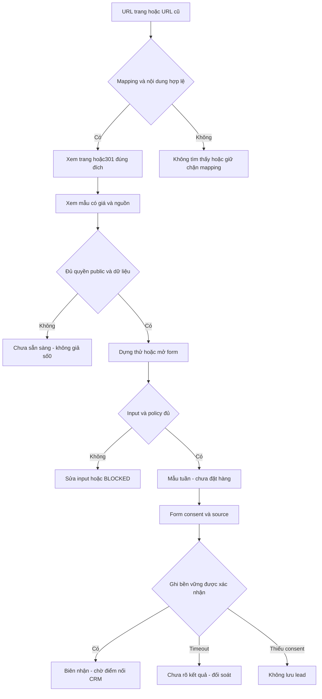
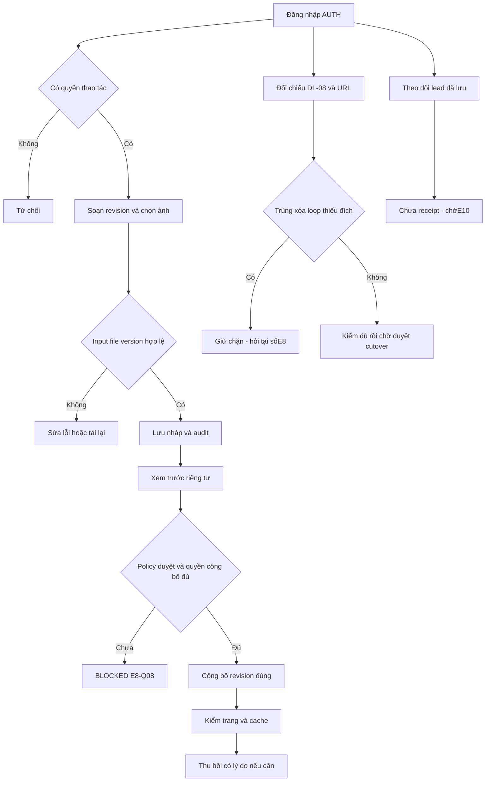

# Luồng khách truy cập và quản trị

Draft · 12/11/2026 · Thiết kế có điều kiện, chưa phê duyệt; 0 backend/migration/UAT.

## Khách: happy / error / edge

Biên: URL đã xóa/trùng chờ E8-Q02; không có mẫu phù hợp thì báo vô nghiệm, không nới hard rule; nguồn thay đổi/stale không tính từ ảnh chụp cũ như hiện hành; truy cập trực tiếp draft không trả nội dung; form không có trial vẫn cần source, không bịa trial. Reload không phát sinh lead.

## Người quản trị: happy / error / edge

Biên: hai người sửa cùng revision →409, không overwrite; thay ảnh đang công khai cần revision, không phá bài cũ; nút publish không tự cấp quyền; thu hồi phải loại bản cache/sitemap. Mất phiên giữ nội dung local nếu policy cho phép E8-Q12, không lưu PII mặc định ở browser.
